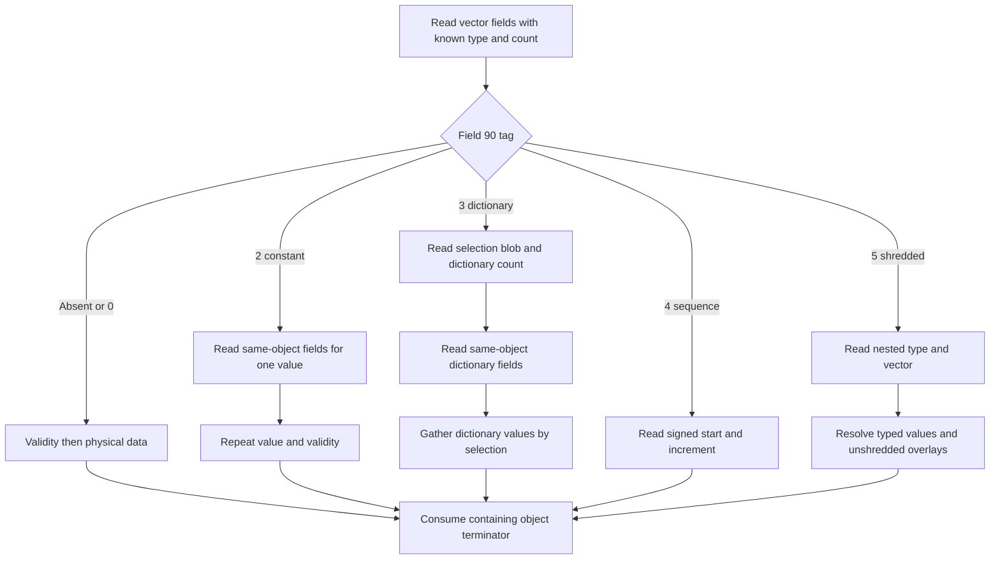

<!--
Copyright (c) 2026 ADBC Drivers Contributors

Licensed under the Apache License, Version 2.0 (the "License");
you may not use this file except in compliance with the License.
You may obtain a copy of the License at

        http://www.apache.org/licenses/LICENSE-2.0

Unless required by applicable law or agreed to in writing, software
distributed under the License is distributed on an "AS IS" BASIS,
WITHOUT WARRANTIES OR CONDITIONS OF ANY KIND, either express or implied.
See the License for the specific language governing permissions and
limitations under the License.
-->

# DuckDB binary encoding used by Quack

This is the encoding companion to [the Quack client protocol reference](QUACK_PROTOCOL.md). It describes the bytes inside Quack HTTP request/response bodies: DuckDB `BinarySerializer`, logical types, `Value`, and `DataChunk`/vector serialization. It is a source-derived implementation reference, not an independently published or stable DuckDB interchange standard.

The primary source is DuckDB commit **`8d68e6f9d887761bf4e4ff6ace906ca6de79d90d`**, the submodule revision pinned by `duckdb-quack` commit `f96420ed46aee9c42064bdb99ddfd1230d6c0086`. This is deliberately different from the sibling DuckDB checkout's HEAD. Source links below pin that revision unless otherwise stated. The encoding was also source-compared against the local **DuckDB `v2.0-cyanoptera` branch at `d54cbbe3df17e8e5ce68312f483b4155836112aa`**; the results are in §1.1. Historical differences were checked against the revisions in §1. No live interoperability test was performed; examples in §9 are constructed fixtures checked with a small independent encoder/reader, not captured server responses.

## 1. Version axes and implementation boundaries

Three independent things matter: Quack message schema, the selected DuckDB storage serialization compatibility level, and the actual DuckDB implementation revision. Quack's handshake version does **not** encode the latter two. The current Quack writer explicitly selects `StorageVersion::V2_0_0`, including both messages and appended chunk blobs. See [Quack serialization options](https://github.com/duckdb/duckdb-quack/blob/f96420ed46aee9c42064bdb99ddfd1230d6c0086/src/quack_message.cpp).

| Quack snapshot | Pinned DuckDB | Serialization target | Relevant encoding behavior |
|---|---|---|---|
| Initial v1 `7a5ee2b21fbca9e52751d286b488868f60854722` | `8a5851971fae891f292c2714d86046ee018e9737` | numeric compatibility index 10 | Historical target; do not interpret this numeric index using current enums. |
| v1 branch `7e80f7ffcc98d0b3e81d0e1df8cc1c2da240a64b` | `08e34c447bae34eaee3723cac61f2878b6bdf787` | numeric index 7 | VARCHAR-like columns use field 102, a list of strings; constant/dictionary/sequence compression exists. |
| v2 merge `3d0369d710c719ac4fafee031bf4b37f8f37caa7` | `53b829b8f0ea2bce3e874769d181f665d2dbf412` | `V1_5_0` | Old string-list column representation. |
| v2 merge `2bb5a01ea2d9ee35d321c6e6793fa24e94099115` | `53b829b8f0ea2bce3e874769d181f665d2dbf412` | `V2_0_0` | Switch to two blobs for ordinary VARCHAR-like columns, without a Quack version increment. |
| Current v3 `f96420ed46aee9c42064bdb99ddfd1230d6c0086` | `8d68e6f9d887761bf4e4ff6ace906ca6de79d90d` | `V2_0_0` | Current type metadata and shredded VARIANT encodings described below. |

The change from numeric target 10 to 7 is visible in [Quack commit 83f79cc](https://github.com/duckdb/duckdb-quack/commit/83f79cc); the later storage-target change is visible in [merge 2bb5a01](https://github.com/duckdb/duckdb-quack/commit/2bb5a01ea2d9ee35d321c6e6793fa24e94099115). Compare [v1 vector serialization](https://github.com/duckdb/duckdb/blob/08e34c447bae34eaee3723cac61f2878b6bdf787/src/common/types/vector.cpp), [early v2 vector serialization](https://github.com/duckdb/duckdb/blob/53b829b8f0ea2bce3e874769d181f665d2dbf412/src/common/types/vector.cpp), and [current vector serialization](https://github.com/duckdb/duckdb/blob/8d68e6f9d887761bf4e4ff6ace906ca6de79d90d/src/common/types/vector.cpp).

Other version-sensitive branches in the current implementation:

| Storage compatibility | Change |
|---|---|
| Before `V1_2_0` | Nested scalar `Value` children always carry their own type. Newer writers may inherit it from the parent. |
| Before `V1_3_0` | Compressed vector serialization is disabled. |
| Before `V1_5_0` | GEOMETRY is converted to the older extension geometry type/SPATIAL blob representation; unbound types use older user-type metadata. |
| Before `V2_0_0` | TUPLE is serialized as unnamed STRUCT; strings use the list representation; shredded vectors are unshredded before serialization. |

For an independent client, implement both ordinary string representations and all emitted vector forms. Do not try to negotiate Arrow or JSON through the binary format: these are DuckDB's own serialized objects. Extension-specific semantics, arbitrary unbound parsed-expression metadata, and the old spatial extension's proprietary geometry blob are explicit boundaries of this document (§10).

### 1.1 DuckDB 2.0 branch comparison

Audited on 2026-10-21 against local `origin/v2.0-cyanoptera` at [`d54cbbe3df17e8e5ce68312f483b4155836112aa`](https://github.com/duckdb/duckdb/tree/d54cbbe3df17e8e5ce68312f483b4155836112aa), a descendant 703 commits beyond the primary DuckDB revision. This branch's [Quack build configuration](https://github.com/duckdb/duckdb/blob/d54cbbe3df17e8e5ce68312f483b4155836112aa/.github/config/extensions/quack.cmake) selects **the same Quack `f96420ed…` source** used by this reference, with no Quack patch list. The release-branch build pairs that extension with the release-branch engine, rather than the extension repository's nested DuckDB gitlink. DuckDB release **2.0**, Quack wire version **3**, and storage serialization target **V2_0_0** are separate identifiers.

**No change was found in the documented concrete-value wire schemas.** The complete binary serializer/deserializer directories, type IDs and metadata codecs, scalar Value codec, DataChunk codec, Vector serializer/deserializer, dictionary/sequence/shredded-vector codecs, raw column storage copies, validity layout, and internal VARIANT iterator/definitions are identical at the two engine revisions. Storage compatibility definitions and the version map are also identical. The same message fields, primitive encodings, vector tags, and chunk grammars therefore apply to this branch snapshot at the source level. Evidence: branch [binary writer](https://github.com/duckdb/duckdb/blob/d54cbbe3df17e8e5ce68312f483b4155836112aa/src/common/serializer/binary_serializer.cpp), [type codec](https://github.com/duckdb/duckdb/blob/d54cbbe3df17e8e5ce68312f483b4155836112aa/src/storage/serialization/serialize_types.cpp), [chunk codec](https://github.com/duckdb/duckdb/blob/d54cbbe3df17e8e5ce68312f483b4155836112aa/src/common/types/data_chunk.cpp), [vector codec](https://github.com/duckdb/duckdb/blob/d54cbbe3df17e8e5ce68312f483b4155836112aa/src/common/types/vector.cpp), and [storage version map](https://github.com/duckdb/duckdb/blob/d54cbbe3df17e8e5ce68312f483b4155836112aa/src/storage/version_map.json).

Identical schemas do not imply identical bytes or query outcomes for every input. The following implementation changes affect values reaching the serializer or accepted by the engine:

| Area | Difference from the primary revision | Client consequence |
|---|---|---|
| Constant/nested nulls and vector copying | Constant nulling checks shared buffers and nested child suitability; list sizing accommodates constant children; copying exotic vectors flattens only the requested selection count. | Corrected values/nulls, with the same flat/constant/dictionary representations. No extra decoder tag or field. [Constant handling](https://github.com/duckdb/duckdb/blob/d54cbbe3df17e8e5ce68312f483b4155836112aa/src/common/vector/constant_vector.cpp), [list sizing](https://github.com/duckdb/duckdb/blob/d54cbbe3df17e8e5ce68312f483b4155836112aa/src/common/vector/list_vector.cpp), [copying](https://github.com/duckdb/duckdb/blob/d54cbbe3df17e8e5ce68312f483b4155836112aa/src/common/types/vector_buffer.cpp). |
| Shredded VARIANT decimals | A decimal is accepted into a typed shredded column only when physical type and scale match and its declared width fits. | Some values use the unshredded remainder instead; support both components and apply the declared decimal scale. [Eligibility check](https://github.com/duckdb/duckdb/blob/d54cbbe3df17e8e5ce68312f483b4155836112aa/src/function/variant/variant_shredding.cpp). |
| VARIANT payload construction | Fixes empty-container offset accounting, resets reserved byte lengths for each row including nulls, and adds checked offset increments in JSON/container conversion. | Use each node's recorded byte offset. Do not assume scalar payloads are gap-free or infer payload offsets by walking preceding nodes. The tags and field widths are unchanged. [Container payloads](https://github.com/duckdb/duckdb/blob/d54cbbe3df17e8e5ce68312f483b4155836112aa/src/include/duckdb/function/cast/variant/to_variant_fwd.hpp), [primitive conversion](https://github.com/duckdb/duckdb/blob/d54cbbe3df17e8e5ce68312f483b4155836112aa/src/include/duckdb/function/cast/variant/primitive_to_variant.hpp), [JSON conversion](https://github.com/duckdb/duckdb/blob/d54cbbe3df17e8e5ce68312f483b4155836112aa/src/include/duckdb/function/cast/variant/json_to_variant.hpp). |
| Specialized-value validation/conversion | WKB analysis rejects dimension flags greater than 3; Parquet VARIANT rejects duplicate object keys; BIGNUM fixes input rounding and failed DOUBLE conversion. | Error/results can differ, but WKB, internal Quack VARIANT, and BIGNUM byte layouts do not. The Parquet VARIANT codec remains distinct from §8. [Geometry](https://github.com/duckdb/duckdb/blob/d54cbbe3df17e8e5ce68312f483b4155836112aa/src/common/types/geometry.cpp), [Parquet variant](https://github.com/duckdb/duckdb/blob/d54cbbe3df17e8e5ce68312f483b4155836112aa/src/common/types/variant/parquet_variant_iterator.cpp), [BIGNUM](https://github.com/duckdb/duckdb/blob/d54cbbe3df17e8e5ce68312f483b4155836112aa/src/common/types/bignum.cpp). |
| HUGEINT and temporal helpers | HUGEINT arithmetic moves into constexpr helpers; TIME/INTERVAL text parsing checks wider ranges and overflow. | The two-half HUGEINT layout and raw temporal layouts stay unchanged. [HUGEINT](https://github.com/duckdb/duckdb/blob/d54cbbe3df17e8e5ce68312f483b4155836112aa/src/include/duckdb/common/hugeint.hpp), [time parsing](https://github.com/duckdb/duckdb/blob/d54cbbe3df17e8e5ce68312f483b4155836112aa/src/common/types/time.cpp). |

One adjacent serialized structure does change: array-slice **ParsedExpression** handling moves from generated code to a manual codec. It writes a legacy omitted-bound expression for targets before V2_0_0 and normalizes that expression on read; the V2_0_0 write path retains the children field. This does not change ordinary query-result types/chunks and remains within the UNBOUND-expression boundary described in §3.2 and §10. [Operator-expression codec](https://github.com/duckdb/duckdb/blob/d54cbbe3df17e8e5ce68312f483b4155836112aa/src/parser/expression/operator_expression.cpp).

The comparison establishes source-level agreement for this exact branch snapshot, not a live cross-version certification or a claim about future commits on the branch. No additional wire profile or Mermaid sequence is required for this engine revision with the configured Quack source.

## 2. Object grammar and primitive codecs

### 2.1 Schema-driven objects

```text
object       := property* END
property     := field_id value_according_to_schema
field_id     := native uint16, exactly 2 bytes
END          := native uint16 65535 (FF FF)
list<T>      := ULEB64(element_count) T repeated element_count times
nullable<T>  := byte(0) | byte(1) T
blob         := ULEB64(byte_count) byte[byte_count]
string       := ULEB32(byte_count) byte[byte_count]
```

`Begin()` writes no bytes. Object boundaries have no length prefix or opening marker. A nested object ends with its own `FF FF`; the enclosing object then continues. Property names such as `"type"` are not transmitted. Field IDs are **fixed-width native-endian**, not LEB128, even though most integer values use LEB128.

Properties must occur in the order specified by their serializer, which need not be numeric order. Mandatory reads consume the next field ID and require an exact match. Optional/default reads peek at the next field ID: a mismatch means that property is absent and supplies its declared default. End-of-object then requires `FF FF`. Unknown properties cannot generally be skipped: there is no length or type information from which to find their end. Reject an unknown schema rather than searching for `FF FF` inside arbitrary data. Default-valued properties are normally omitted entirely; there is no placeholder byte for an omitted property.

Sources: [binary writer](https://github.com/duckdb/duckdb/blob/8d68e6f9d887761bf4e4ff6ace906ca6de79d90d/src/common/serializer/binary_serializer.cpp), [binary reader](https://github.com/duckdb/duckdb/blob/8d68e6f9d887761bf4e4ff6ace906ca6de79d90d/src/common/serializer/binary_deserializer.cpp), [field ID definitions](https://github.com/duckdb/duckdb/blob/8d68e6f9d887761bf4e4ff6ace906ca6de79d90d/src/include/duckdb/common/serializer/serialization_traits.hpp).

### 2.2 Primitive table

| C++ / notation | Encoding |
|---|---|
| `bool` | Raw one-byte 0 or 1. |
| `char` | Raw one byte. |
| `uint8_t`, `uint16_t`, `uint32_t`, `uint64_t` | Unsigned LEB128, with the destination width's range. Even uint8 values ≥128 occupy two bytes. |
| Signed integer types | Signed LEB128 with sign extension; **not** zigzag plus unsigned LEB128. |
| `idx_t` | uint64 / ULEB64 in the inspected source. |
| `sel_t` | uint32; ULEB32 as a scalar, raw uint32 in a selection-vector blob. |
| Enum | Its underlying integer type, not a string. All type IDs and vector tags below have uint8 underlying type. |
| `float`, `double` | Raw native representations, 4/8 bytes on the targeted machines. |
| `hugeint_t` | SLEB64 signed upper half, then ULEB64 unsigned lower half. |
| `uhugeint_t` | ULEB64 upper half, then ULEB64 lower half. |
| `string`, `string_t` | ULEB32 byte length and bytes, with no trailing NUL. May hold arbitrary binary bytes. |
| Raw data pointer with a count | ULEB64 byte length and raw bytes. This length is present even when the expected size is derivable. |
| `optional_idx` | ULEB64 value; `2^64−1` represents unset. There is **no presence boolean**. |
| Optional/pointer-owned object | One presence boolean, followed by the ordinary object if present. |

Both native field IDs and raw arrays are copied from memory without endian conversion. All hex examples below use little-endian, 64-bit DuckDB assumptions. A cross-endian wire contract was not found; do not advertise portable big-endian interoperability based on these bytes. LEB128 bytes themselves are endian-independent. See [writer's raw copy and varint methods](https://github.com/duckdb/duckdb/blob/8d68e6f9d887761bf4e4ff6ace906ca6de79d90d/src/include/duckdb/common/serializer/binary_serializer.hpp), [LEB128 algorithms](https://github.com/duckdb/duckdb/blob/8d68e6f9d887761bf4e4ff6ace906ca6de79d90d/src/include/duckdb/common/serializer/encoding_util.hpp), and [optional index serialization](https://github.com/duckdb/duckdb/blob/8d68e6f9d887761bf4e4ff6ace906ca6de79d90d/src/include/duckdb/common/serializer/serializer.hpp).

Examples: unsigned 127 = `7F`; unsigned 128 = `80 01`; signed 127 = `FF 00`; signed −1 = `7F`; signed −65 = `BF 7F`; unset optional index = `FF FF FF FF FF FF FF FF FF 01`. These examples exclude any preceding field ID.

### 2.3 Containers, pointers and inheritance

Vectors/lists are a count followed by elements, with no terminator for the list itself. Each object element has its own object terminator. A `pair<A,B>` is an object with mandatory property `0:A`, property `1:B`, and END. Maps are lists of such key/value objects; unordered maps have no meaningful entry ordering. `child_list_t<LogicalType>` is a list of pairs `(string name, LogicalType type)`.

Inheritance does not add an extra object layer: a derived type-information object writes the base fields, then subtype fields, then **one** terminator. Pointer ownership does add a presence byte. In particular, Quack's inline `vector<unique_ptr<DataChunkWrapper>>` is:

```text
ULEB64(count)
  byte(1)                         # unique_ptr present
  field_id(300) DataChunk END      # wrapper object; DataChunk has its own END
  ...                             # next pointer/wrapper
```

In that diagram, `DataChunk` includes its own object terminator; the displayed final `END` closes the wrapper. Current appended raw chunk blobs instead contain bare DataChunk objects, without pointer flags or wrappers. See [generic container/pointer serialization](https://github.com/duckdb/duckdb/blob/8d68e6f9d887761bf4e4ff6ace906ca6de79d90d/src/include/duckdb/common/serializer/serializer.hpp) and [Quack wrapper/blob encoding](https://github.com/duckdb/duckdb-quack/blob/f96420ed46aee9c42064bdb99ddfd1230d6c0086/src/quack_message.cpp).

## 3. LogicalType and type information

### 3.1 LogicalType object

| Field, in order | Type | Required/default |
|---|---|---|
| 100 `id` | LogicalTypeId (uint8) | Required |
| 101 `type_info` | nullable LogicalTypeInfo object | Omitted if absent |

The outer type_info property, if present, begins with the pointer presence byte. Simple builtin types normally omit it. A builtin with an alias or extension metadata can have generic type info; do not assume that INTEGER/VARCHAR always has an empty descriptor. [LogicalType serialization](https://github.com/duckdb/duckdb/blob/8d68e6f9d887761bf4e4ff6ace906ca6de79d90d/src/common/types.cpp).

| ID | Logical type | ID | Logical type |
|---|---|---|---|
| 0 | INVALID | 1 | SQLNULL |
| 2 | UNKNOWN | 3 | ANY |
| 4 | UNBOUND | 5 | TEMPLATE |
| 6 | TYPE | 10 | BOOLEAN |
| 11 | TINYINT | 12 | SMALLINT |
| 13 | INTEGER | 14 | BIGINT |
| 15 | DATE | 16 | TIME |
| 17 | TIMESTAMP_SEC | 18 | TIMESTAMP_MS |
| 19 | TIMESTAMP (microseconds) | 20 | TIMESTAMP_NS |
| 21 | DECIMAL | 22 | FLOAT |
| 23 | DOUBLE | 24 | CHAR |
| 25 | VARCHAR | 26 | BLOB |
| 27 | INTERVAL | 28 | UTINYINT |
| 29 | USMALLINT | 30 | UINTEGER |
| 31 | UBIGINT | 32 | TIMESTAMP_TZ |
| 33 | TIMESTAMP_TZ_NS | 34 | TIME_TZ |
| 35 | TIME_NS | 36 | BIT |
| 37 | STRING_LITERAL | 38 | INTEGER_LITERAL |
| 39 | BIGNUM | 49 | UHUGEINT |
| 50 | HUGEINT | 51 | POINTER |
| 53 | VALIDITY | 54 | UUID |
| 60 | GEOMETRY | 100 | STRUCT |
| 101 | LIST | 102 | MAP |
| 103 | TABLE | 104 | ENUM |
| 105 | LEGACY_AGGREGATE_STATE | 106 | LAMBDA |
| 107 | UNION | 108 | ARRAY |
| 109 | VARIANT | 110 | TUPLE |

These are pinned revision IDs, not a promise that every ID can occur as a materialized query column or is accepted by older engines. Planning types such as ANY/UNBOUND/UNKNOWN are not ordinary result-column types. Source: [type IDs and discriminators](https://github.com/duckdb/duckdb/blob/8d68e6f9d887761bf4e4ff6ace906ca6de79d90d/src/include/duckdb/common/types.hpp).

### 3.2 LogicalTypeInfo object

All subtype objects share this base prefix, then append subtype fields in the table below:

| Base field | Value | Required/default |
|---|---|---|
| 100 `type` | LogicalTypeInfoType uint8 discriminator | Required |
| 101 `alias` | string | Empty string |
| 102 `modifiers` | list of Value | Deleted: current writer omits; current reader consumes if present |
| 103 `extension_info` | nullable ExtensionTypeInfo | Absent |

`?` below means an omitted field takes its zero/empty default. A type descriptor may still require a nonzero field semantically, e.g. DECIMAL width.

| Discriminator | Subtype | Fields after the base prefix |
|---|---|---|
| 0 | INVALID | No usable type info. |
| 1 | GENERIC | None. |
| 2 | DECIMAL | `200:width uint8?`, `201:scale uint8?`. |
| 3 | STRING | `200:collation string?`. |
| 4 | LIST | `200:child_type LogicalType`. Also used by MAP's list-of-struct representation. |
| 5 | STRUCT | `200:child_types list<pair<string,LogicalType>>?`. Also supplies UNION, TUPLE and VARIANT layouts. |
| 6 | ENUM | `200:values_count idx_t`, `201:values list<string>` in dictionary order. |
| 7 | UNBOUND | Current target: `204:expr nullable ParsedExpression?`; legacy fields 200–203 are described below. |
| 8 | LEGACY_AGGREGATE_STATE | Deleted fields `200:string`, `201:LogicalType`, `202:list<LogicalType>` may be read; current writer omits them. |
| 9 | ARRAY | `200:child_type LogicalType`, `201:size uint32?`. |
| 10 | ANY | `200:target_type LogicalType`, `201:cast_score idx_t?`. |
| 11 | INTEGER_LITERAL | `200:constant_value Value`. |
| 12 | TEMPLATE | `200:name string?`. |
| 13 | GEO | `200:crs CoordinateReferenceSystem object`. |

CoordinateReferenceSystem is an object with optional `100:definition string`, default empty. Preserve the definition; parsing names/identifiers is separate from decoding. ExtensionTypeInfo is an object with optional `100:modifiers list<LogicalTypeModifier>` and `101:properties map<string,Value>`, both default empty. Each LogicalTypeModifier is an object with required `100:value Value` and optional `101:label string` (empty default).

Older UNBOUND metadata used optional `200:name`, `201:catalog`, `202:schema` strings and `203:user_type_modifiers list<Value>`. Current `V1_5_0+` serialization instead writes the parsed expression in field 204, requiring DuckDB's full expression schema to interpret it. An ordinary SQL-result client should report this as an unsupported descriptor, not silently skip it. The broad ParsedExpression grammar is outside this companion.

Sources: [generated type serializers](https://github.com/duckdb/duckdb/blob/8d68e6f9d887761bf4e4ff6ace906ca6de79d90d/src/storage/serialization/serialize_types.cpp), [manual enum/unbound serializers](https://github.com/duckdb/duckdb/blob/8d68e6f9d887761bf4e4ff6ace906ca6de79d90d/src/common/logical_type_info.cpp), [CRS serializer](https://github.com/duckdb/duckdb/blob/8d68e6f9d887761bf4e4ff6ace906ca6de79d90d/src/common/types/geometry_crs.cpp).

## 4. Logical values and physical column storage

### 4.1 Fixed-width column layout

The following table applies to a vector's **raw data blob**, not to a scalar `Value` or a Quack message property. In a little-endian implementation, each element is little-endian. Raw hugeint memory stores **lower then upper**, opposite to the scalar codec's upper-then-lower LEB128 order.

| Logical type | Raw column element | Meaning |
|---|---|---|
| BOOLEAN / TINYINT / UTINYINT | 1 byte | Boolean 0/1, signed int8, unsigned uint8. |
| SMALLINT / USMALLINT | 2 bytes | Signed/unsigned integer. |
| INTEGER / UINTEGER / SQLNULL | 4 bytes | Signed/unsigned integer; SQLNULL validity marks null. |
| BIGINT / UBIGINT | 8 bytes | Signed/unsigned integer. |
| HUGEINT / UHUGEINT | 16 bytes | uint64 lower, int64/uint64 upper. |
| FLOAT / DOUBLE | 4 / 8 bytes | Native floating-point representation. |
| DATE | int32 | Days since 1970-01-01; ±2147483647 represent ±infinity. |
| TIME / TIME_NS | int64 | Microseconds/nanoseconds since midnight. |
| TIMESTAMP_SEC / MS / TIMESTAMP / NS | int64 | Seconds/milliseconds/microseconds/nanoseconds since Unix epoch. |
| TIMESTAMP_TZ / TIMESTAMP_TZ_NS | int64 | UTC epoch microseconds/nanoseconds; no per-value time-zone name. |
| TIME_TZ | 8 bytes interpreted as uint64 bits | `micros = bits >> 24`; `offset_seconds = 57599 - (bits & 0xFFFFFF)`. |
| INTERVAL | 16 bytes | int32 months, int32 days, int64 microseconds, in that order. |
| DECIMAL(w,s) | Signed int16/int32/int64/int128 | Width 1–4/5–9/10–18/19–38; logical value is integer ×10^(−s). |
| ENUM | uint8/uint16/uint32 | Dictionary index; width chosen by **dictionary count** ≤255 / ≤65535 / otherwise. Count 256 therefore uses uint16. |
| UUID | 16 bytes | Hugeint storage with upper sign bit flipped relative to conventional UUID bits; see below. |

Timestamp sentinel handling should follow the [pinned timestamp types](https://github.com/duckdb/duckdb/blob/8d68e6f9d887761bf4e4ff6ace906ca6de79d90d/src/include/duckdb/common/types/timestamp_base.hpp); the implementation uses ±maximum int64 for infinities in its timestamp representation. Do not turn null payload sentinels into actual values: validity is authoritative. The writer supplies `NullValue<T>()` bytes for null fixed-width entries, but consumers must ignore those bytes rather than infer nullness from them.

To convert UUID storage to conventional hexadecimal, read the two halves, XOR upper with `0x8000000000000000`, then format upper's 16 hex digits followed by lower's 16 digits with UUID hyphen placement. When creating a UUID, perform the inverse transformation before either scalar or column encoding. A message UUID represented as `hugeint_t` still uses the scalar codec in §2, not the raw 16-byte column layout.

Sources: [logical-to-physical mappings](https://github.com/duckdb/duckdb/blob/8d68e6f9d887761bf4e4ff6ace906ca6de79d90d/src/common/types.cpp), [column storage copies](https://github.com/duckdb/duckdb/blob/8d68e6f9d887761bf4e4ff6ace906ca6de79d90d/src/common/vector_operations/vector_storage.cpp), [hugeint layout](https://github.com/duckdb/duckdb/blob/8d68e6f9d887761bf4e4ff6ace906ca6de79d90d/src/include/duckdb/common/hugeint.hpp), [UUID conversion](https://github.com/duckdb/duckdb/blob/8d68e6f9d887761bf4e4ff6ace906ca6de79d90d/src/common/types/uuid.cpp), [time-zone bit layout](https://github.com/duckdb/duckdb/blob/8d68e6f9d887761bf4e4ff6ace906ca6de79d90d/src/include/duckdb/common/types/datetime.hpp), [date layout](https://github.com/duckdb/duckdb/blob/8d68e6f9d887761bf4e4ff6ace906ca6de79d90d/src/include/duckdb/common/types/date.hpp).

### 4.2 Variable-width and nested semantics

| Type | Interpretation after decoding its vector |
|---|---|
| VARCHAR / CHAR | Text bytes; byte length is not a character count. |
| BLOB | Arbitrary bytes; no text escaping in column storage. |
| BIT | First byte is padding count 0–7, followed by packed bits. Skip that many most-significant bits of the first data byte, then read MSB first. Padding bits are set to 1. |
| BIGNUM | Three-byte big-endian header plus big-endian magnitude bytes; see below. |
| GEOMETRY | Current writer sends WKB with format tag 1 using the special list encoding in §6, even under V2. |
| LIST | Child vector and per-row offset/length pairs. |
| MAP | LIST of STRUCT with `key` and `value` children. |
| STRUCT / TUPLE | One child vector per type-info child; parent and each child have their own validity. |
| UNION | STRUCT whose first child is the UTINYINT tag, followed by member vectors. Tag 0 selects first member, which occupies physical child 1. |
| ARRAY | Fixed number of child elements per parent row. |
| VARIANT | Physical STRUCT or shredded form described in §8. |

BIGNUM: a high bit set in header byte 0 means nonnegative. For negative values, complement each of the three header bytes and every magnitude byte. Interpret the resulting 24-bit header as `0x800000 | magnitude_byte_count`; its low 23 bits must agree with the remaining length. Interpret the magnitude big-endian, then apply the sign. At least one magnitude byte exists; zero is `80 00 01 00`. This is sign-and-magnitude with complementing for negative values, not two's complement.

Sources: [BIT conversion](https://github.com/duckdb/duckdb/blob/8d68e6f9d887761bf4e4ff6ace906ca6de79d90d/src/common/types/bit.cpp), [BIGNUM conversion](https://github.com/duckdb/duckdb/blob/8d68e6f9d887761bf4e4ff6ace906ca6de79d90d/src/common/types/bignum.cpp), [nested type constructors](https://github.com/duckdb/duckdb/blob/8d68e6f9d887761bf4e4ff6ace906ca6de79d90d/src/common/types.cpp).

## 5. Scalar Value objects

`Value` is used by metadata, extension properties and other DuckDB serialized structures. It is **not** the per-cell representation of a DataChunk.

| Field, in order | Encoding |
|---|---|
| 100 `type` | LogicalType object. Required for root Values; may be omitted for nested Values whose parent supplies a concrete type. |
| 101 `is_null` | Required boolean. If true, the object ends here. |
| 102 `value` | Required for non-null values; representation depends on the physical type below. |
| 103 `geometry_format` | Only current GEOMETRY scalar: uint8 WKB = 1, after the value. |

For ordinary numeric types, field 102 uses the scalar primitive codecs in §2. INTERVAL uses a nested object with optional `1:months int32`, `2:days int32`, `3:micros int64`, all zero by default. TYPE has a LogicalType object as its value. Ordinary VARCHAR-like values are serialized strings. BLOB and GEOMETRY are exceptions: they use DuckDB's escaped blob text in field 102; a byte escape is the four ASCII characters `\xHH`, not a single byte. The escape representation is reversed with DuckDB's blob rules before interpreting the payload. Column BLOBs, in contrast, are raw bytes. To write a safe scalar blob, encoding every byte as `\xHH` is accepted by the reader, even if DuckDB's writer leaves printable ordinary characters unescaped.

Nested LIST/MAP/STRUCT/TUPLE/UNION/ARRAY Values use field 102 as an object containing `100:children list<Value>`. Children inherit the list/array element type or the corresponding struct child type. Newer writers omit each child's field 100 if its type can be inherited; when the expected type has no concrete physical representation, a child carries its own type. Keep this inherited type in a recursive decoder context. Older, explicitly typed children remain readable. Each child is still an object with its own is_null field and terminator.

Sources: [Value serialization/deserialization](https://github.com/duckdb/duckdb/blob/8d68e6f9d887761bf4e4ff6ace906ca6de79d90d/src/common/types/value.cpp), [interval scalar serializer](https://github.com/duckdb/duckdb/blob/8d68e6f9d887761bf4e4ff6ace906ca6de79d90d/src/storage/serialization/serialize_nodes.cpp), [blob escaping](https://github.com/duckdb/duckdb/blob/8d68e6f9d887761bf4e4ff6ace906ca6de79d90d/src/common/types/blob.cpp).

## 6. DataChunk and ordinary vectors

### 6.1 Chunk envelope

| Field, in order | Encoding |
|---|---|
| 100 `rows` | uint32 scalar (ULEB32) |
| 101 `types` | list<LogicalType>, one per column |
| 102 `columns` | list<vector object>, one per type in the same order |

A chunk does not include column names. Read them from Quack's result schema when supplied. Every chunk repeats types; verify number/types against the statement's advertised schema when that schema is available. An upload PREPARE can return on `client_data_pending` before the final schema is bound, with empty names/types; later chunks carry their own types but do not recover missing column names. Do not reject those chunks solely because the earlier PREPARE schema was empty; the protocol reference describes this upload limitation. The vector reader receives the row count and logical type from the chunk envelope; those are not repeated in every vector. Standard DuckDB processing batches often contain 2048 rows, but the wire carries a count: do not hard-code 2048 as the parser's length. [DataChunk serializer/deserializer](https://github.com/duckdb/duckdb/blob/8d68e6f9d887761bf4e4ff6ace906ca6de79d90d/src/common/types/data_chunk.cpp).

### 6.2 Flat vector prefix

First examine optional field 90 (`vector_type`, default FLAT=0). Non-flat encodings are in §7. A flat vector then has:

| Field, in order | Encoding |
|---|---|
| 99 `geometry_format` | Only GEOMETRY: uint8; current writer emits WKB=1; reader defaults missing tag to SPATIAL=0. |
| 100 `has_validity_mask` | Required boolean. |
| 101 `validity` | Required blob iff field 100 is true. |
| Remaining fields | Type-dependent data below. |

Validity is `ceil(count/64)` raw native uint64 words, so the blob length is **8 × ceil(count/64)**, not ceil(count/8). Bit `i % 64` of word `i / 64` is 1 for valid and 0 for null. Ignore padding bits past count. A present mask may have all rows valid; absence means all valid. Both the declared blob length and actual byte availability must match the expected size. Sources: [vector serialization](https://github.com/duckdb/duckdb/blob/8d68e6f9d887761bf4e4ff6ace906ca6de79d90d/src/common/types/vector.cpp), [validity layout](https://github.com/duckdb/duckdb/blob/8d68e6f9d887761bf4e4ff6ace906ca6de79d90d/src/include/duckdb/common/types/validity_mask.hpp).

### 6.3 Type-dependent vector fields

| Physical/logical family | Fields after validity |
|---|---|
| Fixed-width | `102:data blob`; size exactly `count × element_width`. |
| Ordinary VARCHAR-like, V2 form | `107:byte_data_length optional_idx` (present and valid, even if zero); `108:length_data blob` of exactly `count × 4` bytes; `109:byte_data blob` of exactly byte_data_length bytes. |
| Ordinary VARCHAR-like, old form | `102:data list<string>`, with exactly count entries. |
| GEOMETRY | `102:data list<string>`, with exactly count entries; each valid entry is geometry bytes in the tagged format. |
| STRUCT/TUPLE/UNION/VARIANT | `103:children list<vector object>`; each vector receives the same count and its corresponding child type. |
| LIST/MAP | `104:list_size idx_t`; `105:entries list<object>` of count entries; `106:child vector object` with list_size elements. |
| ARRAY | `103:array_size uint64`; `104:child vector object` with `array_size × count` elements. |

The V2 `length_data` blob is a packed array of native uint32 byte lengths. Null entries have length zero in the writer. Concatenate valid entry bytes in row order; do not consume bytes for null rows. Empty non-null strings also have zero length and are distinguished by validity. Although a source comment says length_data's length need not be encoded, the actual `WriteProperty(ptr,count)` still writes the blob length prefix: **do include it**. An old/new decoder chooses the V2 form when field 107 is present with a valid optional index; otherwise it expects field 102. It does not inspect a standalone storage-version byte.

Each LIST entry object contains required `100:offset idx_t`, `101:length idx_t`, then END. Null list entries are written with zero offset and length. Valid empty lists have length zero but valid parent bits. Offsets refer to the serialized child vector and need not be contiguous or start at zero. Check `offset <= list_size` and `length <= list_size - offset`. Child vectors have their own validity. ARRAY's child position for parent row i is `i × array_size`; array_size should agree with LogicalType metadata.

A writer for insertion can emit flat vectors without field 90. A reader must handle compressed forms because `DataChunk::Serialize` defaults to compressed serialization. GEOMETRY bypasses the V2 two-blob string branch; BLOB, BIT and BIGNUM use that branch because they have VARCHAR physical storage. See [vector writer and reader](https://github.com/duckdb/duckdb/blob/8d68e6f9d887761bf4e4ff6ace906ca6de79d90d/src/common/types/vector.cpp) and [default DataChunk compression option](https://github.com/duckdb/duckdb/blob/8d68e6f9d887761bf4e4ff6ace906ca6de79d90d/src/include/duckdb/common/types/data_chunk.hpp).

## 7. Compressed vector forms

These are vector encodings within a serialized chunk, independent of any HTTP Content-Encoding.

| Tag in field 90 | Name | Encoding immediately after field 90 |
|---|---|---|
| 0 (normally omitted) | FLAT | Flat prefix and data in §6. |
| 1 | FSST | Not emitted by the inspected serializer and not accepted by the inspected VectorBuffer deserializer. In-memory FSST vectors are normalized for serialization. Reject an unexpected wire tag 1. |
| 2 | CONSTANT | Decode vector fields again with count=1, **in the same object**, then repeat that single value count times. |
| 3 | DICTIONARY | `91:sel_vector blob`, `92:dict_count idx_t`, then dictionary vector fields **in the same object**, decoded with count=dict_count. |
| 4 | SEQUENCE | `91:seq_start int64`, `92:seq_increment int64`, then object END. Element i is start+i×increment in the logical type. |
| 5 | SHREDDED | `91:shredded_type LogicalType`, `92:shredded_data vector object`, then END. See §8. |

Constant/dictionary recursion consumes fields, not an extra nested object's terminator. There is just one final END for their containing vector. Their embedded ordinary vector usually has no field 90, so recursion defaults to flat. Dictionary selection data contains exactly count raw uint32 indices (4×count bytes); each index must be less than dict_count. Nullness comes from the referenced dictionary entry. The writer can remap a dictionary to only the used values; no dictionary identity persists across chunks.

Sequence data uses scalar **signed LEB128**, not a raw two-int64 blob. It has no separate validity mask: all emitted elements are valid. Validate arithmetic in a wide representation before conversion. The compression decision is an implementation detail: a client must accept a flat representation of the same values.

Sources: [vector tags](https://github.com/duckdb/duckdb/blob/8d68e6f9d887761bf4e4ff6ace906ca6de79d90d/src/include/duckdb/common/enums/vector_type.hpp), [vector dispatch](https://github.com/duckdb/duckdb/blob/8d68e6f9d887761bf4e4ff6ace906ca6de79d90d/src/common/types/vector.cpp), [buffer dispatch](https://github.com/duckdb/duckdb/blob/8d68e6f9d887761bf4e4ff6ace906ca6de79d90d/src/common/types/vector_buffer.cpp), [dictionary fields](https://github.com/duckdb/duckdb/blob/8d68e6f9d887761bf4e4ff6ace906ca6de79d90d/src/common/vector/dictionary_vector.cpp), [sequence fields](https://github.com/duckdb/duckdb/blob/8d68e6f9d887761bf4e4ff6ace906ca6de79d90d/src/common/vector/sequence_vector.cpp).



## 8. VARIANT

### 8.1 Ordinary unshredded form

The logical VARIANT type has STRUCT metadata with these children, in order:

```text
keys      LIST<VARCHAR>
children  LIST<STRUCT(keys_index UINTEGER, values_index UINTEGER)>
values    LIST<STRUCT(type_id UTINYINT, byte_offset UINTEGER)>
data      BLOB
```

Decode these using ordinary struct/list/blob vector rules first. For each valid row, the root node is `values[0]`. All keys/children/values indices below are **relative to that row's list**, not global offsets into the underlying list child vector; add the list entry's offset when indexing physical arrays. `byte_offset` addresses the start of a node payload in that row's data blob. SQL NULL is represented by row validity, distinct from a valid row whose node has VARIANT_NULL tag.

| VariantLogicalType tag | Meaning / payload in data blob |
|---|---|
| 0 | VARIANT_NULL; no value payload. |
| 1 / 2 | Boolean true / false; no value payload. |
| 3 / 4 / 5 / 6 / 7 | Signed int8/int16/int32/int64/int128 in native fixed width. |
| 8 / 9 / 10 / 11 / 12 | Unsigned uint8/uint16/uint32/uint64/uint128 in native fixed width. |
| 13 / 14 | float / double in native fixed width. |
| 15 | DECIMAL: ULEB32 width, ULEB32 scale, then raw signed integer of the width-derived storage size. |
| 16 / 17 | VARCHAR / BLOB: ULEB32 byte length, then raw bytes. |
| 18 | UUID: raw hugeint representation, including sign-bit transformation. |
| 19 | DATE: raw int32. |
| 20 / 21 | TIME microseconds / nanoseconds: raw int64. |
| 22 / 23 / 24 / 25 | TIMESTAMP seconds / milliseconds / microseconds / nanoseconds: raw int64. |
| 26 / 27 | TIME_TZ packed bits / TIMESTAMP_TZ microseconds: raw 8 bytes. |
| 28 | INTERVAL: raw months/days/microseconds layout. |
| 29 / 30 | OBJECT / ARRAY: ULEB32 child_count, and if nonzero, ULEB32 first_children_index. |
| 31 / 32 / 33 | BIGNUM / BITSTRING / GEOMETRY: length-prefixed string bytes, with the respective type's payload semantics. |
| 34 | TIMESTAMP_TZ nanoseconds: raw int64. |

For an OBJECT/ARRAY, visit child_count entries in the row's children list starting at first_children_index. Each entry's values_index selects the child node from values. An object's keys_index selects a string from keys. Array entries have no object key; do not require a valid keys_index for them. A node's scalar data is not a BinarySerializer object and has no field IDs or END marker. Its short unsigned lengths use the separate `VarintDecode` implementation, which follows the same seven-bit continuation encoding for the unsigned values described here.

This internal four-column layout is distinct from the Spark/Parquet VARIANT encoding also present in the repository. Do not feed its data blob to the Parquet variant binary decoder. Sources: [VARIANT logical layout](https://github.com/duckdb/duckdb/blob/8d68e6f9d887761bf4e4ff6ace906ca6de79d90d/src/common/types.cpp), [tag enumeration](https://github.com/duckdb/duckdb/blob/8d68e6f9d887761bf4e4ff6ace906ca6de79d90d/src/include/duckdb/common/types/variant.hpp), [payload decoding and nested traversal](https://github.com/duckdb/duckdb/blob/8d68e6f9d887761bf4e4ff6ace906ca6de79d90d/src/common/types/variant/variant_iterator.cpp), [decimal/string/nested payload helpers](https://github.com/duckdb/duckdb/blob/8d68e6f9d887761bf4e4ff6ace906ca6de79d90d/src/function/scalar/variant/variant_utils.cpp).

### 8.2 Shredded vector form

The outer vector is logical VARIANT with tag 5. Field 91 supplies a STRUCT LogicalType with two children: the unshredded VARIANT component first, and the shredded typed component second. Field 92 is an ordinary nested vector object with that supplied type and the original row count. Its STRUCT/list children may themselves use the ordinary compression mechanisms.

Resolve the second component using the pinned iterator's rules:

1. The top-level shredded component's validity determines SQL NULL rows before resolving values.
2. A non-STRUCT node is a typed leaf/container. Its logical type determines the VARIANT tag. A null value resolves to null.
3. A STRUCT resolution node is a wrapper with first child `typed_value` and optional second child `untyped_value_index`.
4. If typed_value is valid, use it. For a typed STRUCT object, also merge the leftover unshredded object identified by a valid, nonzero untyped_value_index. That index is **one-based** into the row's unshredded values list. Typed list/array/scalar values do not use the overlay in this branch.
5. If typed_value is null and the wrapper has no overlay child, or that child is null, the result is null. A valid overlay index of zero means **missing**, not null. A positive index selects the unshredded node at index−1.
6. Enumerate typed object fields in schema order, resolving each field wrapper and omitting missing fields; then enumerate leftover overlay-object fields. Lists/arrays resolve element wrappers. Preserve missing versus explicit null during reconstruction. A missing root is treated as SQL NULL by the source iterator.

This is a semantic reconstruction algorithm, not a claim that arbitrary STRUCT data is a valid shredded VARIANT. Validate the supplied outer type and wrapper shapes before following indices. The implementation enforces outer logical VARIANT and a two-child STRUCT at dispatch; additional structural checks in a client protect against malformed payloads. Sources: [shredded wire serializer](https://github.com/duckdb/duckdb/blob/8d68e6f9d887761bf4e4ff6ace906ca6de79d90d/src/common/vector/shredded_vector.cpp), [root validity, wrapper resolution, and overlay traversal](https://github.com/duckdb/duckdb/blob/8d68e6f9d887761bf4e4ff6ace906ca6de79d90d/src/common/types/variant/variant_iterator.cpp).

## 9. Annotated byte examples

Spaces and line breaks below are explanatory. These are little-endian examples. Independent checks covered primitive signed/unsigned LEB128 examples, constructed INTEGER/Value/VARCHAR/chunk framing, and a complete connection request parsed by an ordered-schema reader; they did not execute DuckDB or generate a server capture.

### 9.0 Complete Quack CONNECTION_REQUEST

This is a 32-byte current-profile HTTP request body: two adjacent BinarySerializer objects, with no additional length/magic prefix. The illustrative authentication string is `x`, minimum/maximum Quack version are 3, requested heartbeat timeout is 60 seconds, and the initial connection ID and informational strings are empty/omitted. Authentication succeeds only if `x` is valid for the target server; this example specifies encoding, not a usable credential.

```text
01 00 01                              # header field 1: CONNECTION_REQUEST=1
03 00                                 # header field 3: client_query_id (required)
  FF FF FF FF FF FF FF FF FF 01       # UINT64_MAX means unset
FF FF                                 # header END
01 00 01 78                           # body field 1: auth string, length=1, 'x'
04 00 03                              # body field 4: minimum version=3
05 00 03                              # body field 5: maximum version=3
07 00 3C                              # body field 7: heartbeat timeout=60
FF FF                                 # body END
```

Header field 2 is omitted because the connection ID is empty. Header field 3 is **not** omitted: it is a required field whose value happens to be an unset optional index. Body fields 2, 3, and 6 are omitted as empty strings. The independently constructed bytes were decoded with an ordered-schema reader checking both terminators, all required/default fields, the authentication/version/timeout values, and exact end-of-input. Source: [Quack message serializers](https://github.com/duckdb/duckdb-quack/blob/f96420ed46aee9c42064bdb99ddfd1230d6c0086/src/serialize_quack_message.cpp).

### 9.1 INTEGER LogicalType and Value(42)

```text
64 00 0D FF FF                         # LogicalType: field 100, ID 13, END

64 00                                 # Value field 100: type
  64 00 0D FF FF                       # INTEGER LogicalType
65 00 00                              # field 101: is_null=false
66 00 2A                              # field 102: signed LEB128 42
FF FF                                 # Value END
```

A nullable INTEGER Value is the same through its type, followed by `65 00 01 FF FF`, with no value property. A nested INTEGER Value inheriting its type may start directly with `65 00`.

### 9.2 Flat INTEGER vector [42, NULL]

```text
64 00 01                              # field 100: has_validity_mask=true
65 00 08                              # field 101: blob length 8
  FD FF FF FF FF FF FF FF             # row 0 valid, row 1 invalid; padding ignored
66 00 08                              # field 102: blob length 8
  2A 00 00 00                         # int32 42
  00 00 00 80                         # int32 null payload sentinel; validity wins
FF FF                                 # vector END
```

Wrap it as a one-column, two-row DataChunk:

```text
64 00 02                              # rows=2
65 00 01                              # types list count=1
  64 00 0D FF FF                       # INTEGER LogicalType
66 00 01                              # columns list count=1
  <the complete vector above>
FF FF                                 # chunk END
```

The vector blob's int32 42 is `2A 00 00 00`; the scalar Value's 42 was just `2A`. An inline Quack DataChunkWrapper adds `01 2C 01` before the complete chunk and `FF FF` after it: pointer-present byte, field 300, chunk object, wrapper END.

### 9.3 V2 VARCHAR vector ["A", ""]

```text
64 00 00                              # no validity mask
6B 00 01                              # field 107: byte_data_length=1
6C 00 08                              # field 108: length_data blob length=8
  01 00 00 00 00 00 00 00             # lengths [1, 0]
6D 00 01 41                           # field 109: blob length 1, byte 'A'
FF FF
```

The old string-list representation of the same vector is `64 00 00 66 00 02 01 41 00 FF FF`: no validity mask, field 102, two strings, lengths 1 and 0, END.

### 9.4 Constant and sequence vectors

```text
5A 00 02                              # field 90: CONSTANT=2
64 00 00                              # embedded one-row flat vector: no mask
66 00 04 2A 00 00 00                  # embedded INTEGER data blob
FF FF                                 # one END, not two

5A 00 04                              # field 90: SEQUENCE=4
5B 00 0A                              # field 91: signed start=10
5C 00 02                              # field 92: signed increment=2
FF FF
```

The outer chunk supplies count. The second encoding represents `[10,12,14,...]` through that count.

## 10. Client implementation and validation checklist

Implement decoding in layers: bounded byte reader → scalar codec → ordered object schemas → LogicalType/Value → vector fields with caller-supplied type/count → chunk → Quack message/body framing. Keep “read vector fields” separate from “consume object END” so constant/dictionary encodings do not consume an extra terminator. Enforce allocation and recursion limits before allocating from wire counts.

At minimum, verify these cases with a server matching the intended Quack revision:

- Signed LEB128 boundaries (−65, −64, 63, 64, int64 extremes), unsigned limits, truncated/overlong encodings, optional_idx unset versus zero.
- Empty/default fields, nullable pointer flags, nested object terminators, map/pair field IDs, unknown/unexpected fields.
- All fixed-width types, infinities, decimal widths 4/5/9/10/18/19, ENUM count thresholds 255/256 and 65535/65536, UUID conversion, BLOB embedded zero bytes.
- Mask lengths for 0/1/63/64/65 rows; all-valid masks; null versus empty strings and lists; old and V2 string formats.
- Constant, dictionary and sequence vectors; dictionary bounds; nested vectors compressed independently; list offset ranges and array multiplication overflow.
- STRUCT/TUPLE/UNION parent and child nulls; MAP key/value reconstruction; BIT and signed BIGNUM payloads; WKB GEOMETRY.
- Unshredded VARIANT scalar/array/object rows, nested object indices, SQL NULL versus VARIANT null, and shredded typed/overlay/missing cases.
- Inline chunk wrappers with pointer flags versus appended raw chunk objects, exact chunk count, truncation, and trailing-byte handling defined by the Quack profile.

Validate lengths against remaining bytes before reads, and size products/sums before allocation. Limit recursion in type descriptors, Values and nested vectors. Validate string length sums, dictionary indices, list ranges, VARIANT key/value/child indices and payload bounds. Do not assume serialized null payload bytes are safe to interpret. These are recommendations for an independent reader; they should not be mistaken for claims that every pinned DuckDB decoder enforces every check.

Known boundaries:

- This covers the primary revision and the explicitly audited DuckDB 2.0 branch snapshot in §1.1, not exhaustive compatibility testing across DuckDB releases or every intermediate Quack commit. The history table identifies the important known switches; matching a Quack version alone is insufficient.
- Extension aliases and generic properties can be preserved with the schemas above, but arbitrary extension-specific semantics require that extension's definition. Unknown field-bearing type schemas cannot be skipped generically.
- The current UNBOUND parsed-expression field requires the separate DuckDB expression serialization schemas. Reject it explicitly if unsupported; it is not needed for ordinary concrete result-column types.
- Legacy SPATIAL geometry blobs require the historical spatial codec; the WKB path is documented here. Source for conversions: [Geometry implementation](https://github.com/duckdb/duckdb/blob/8d68e6f9d887761bf4e4ff6ace906ca6de79d90d/src/common/types/geometry.cpp). Planner/internal types such as POINTER, VALIDITY, LAMBDA and TYPE columns are not presented as a portable application interchange contract.
- VARIANT/shredded reconstruction above follows the pinned implementation, but has not been cross-tested against generated fixtures. A client advertising support should test both representations; otherwise surface an explicit unsupported-type error rather than return a lossy JSON guess.

For message IDs, handshake/authentication, request ordering, fetch acknowledgement and insertion flow control, continue with [QUACK_PROTOCOL.md](QUACK_PROTOCOL.md).
