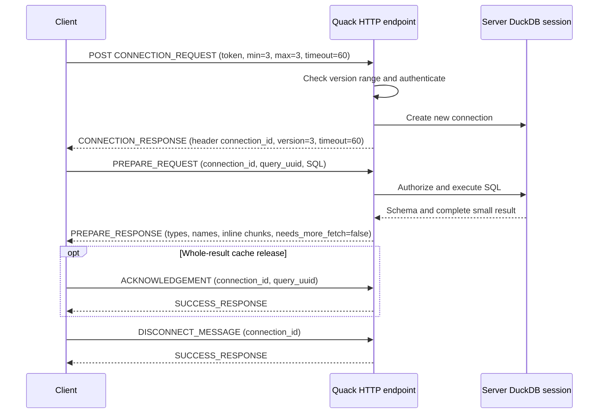
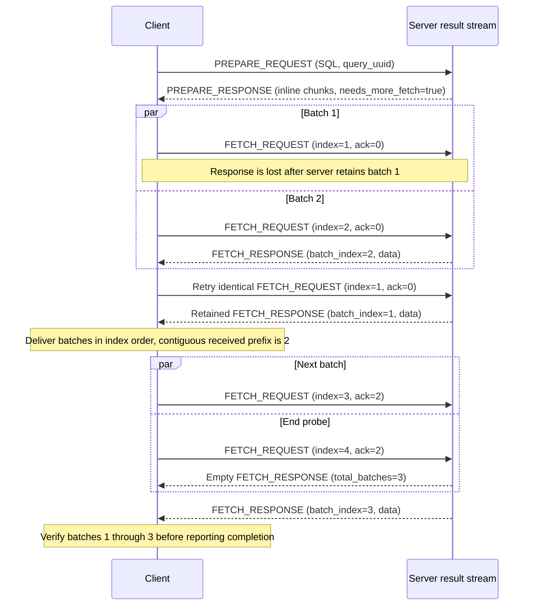
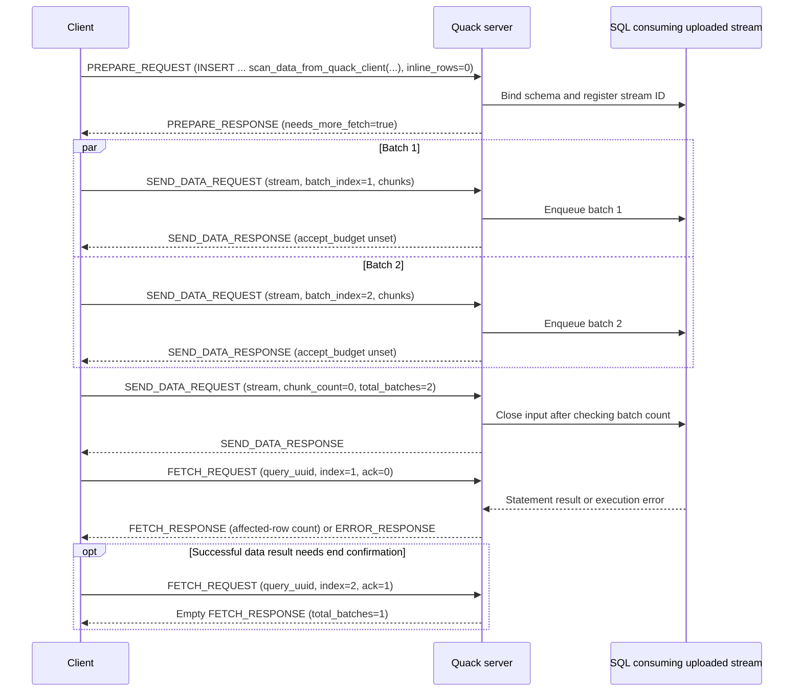
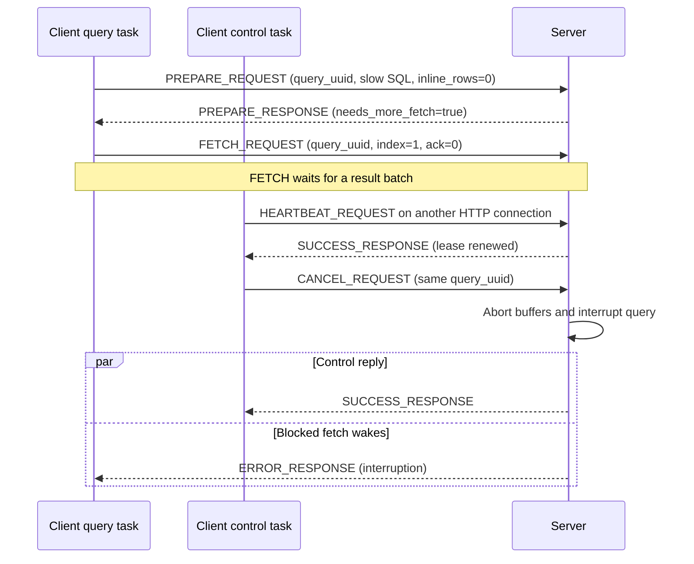
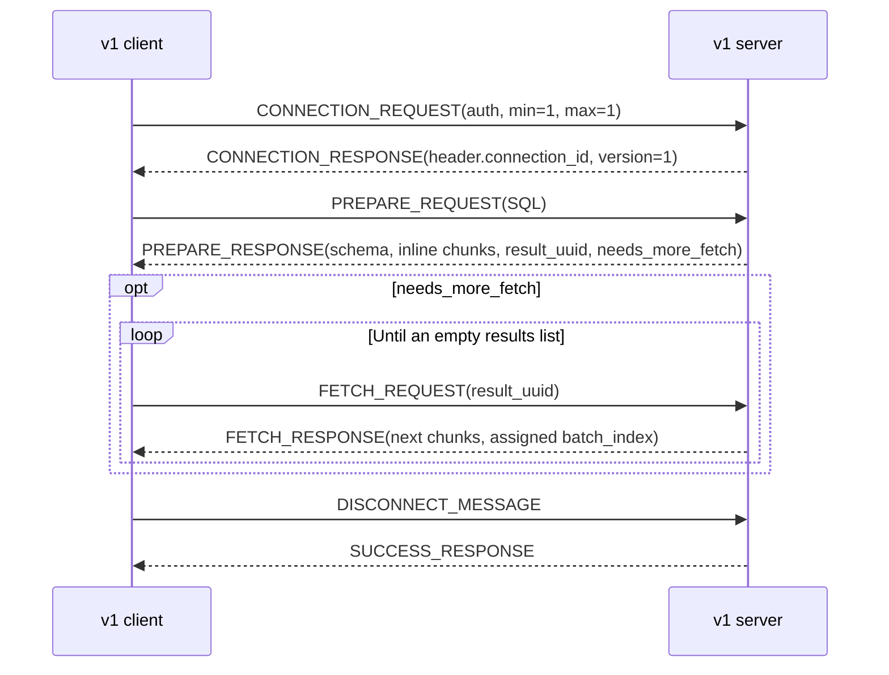
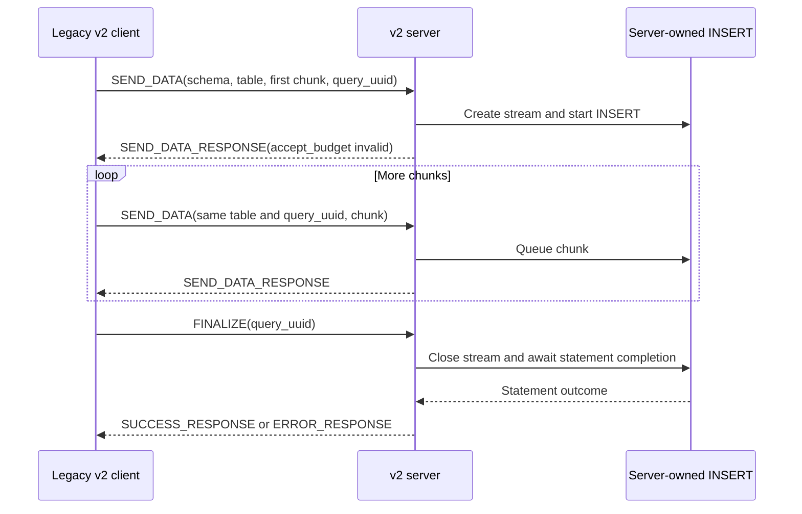
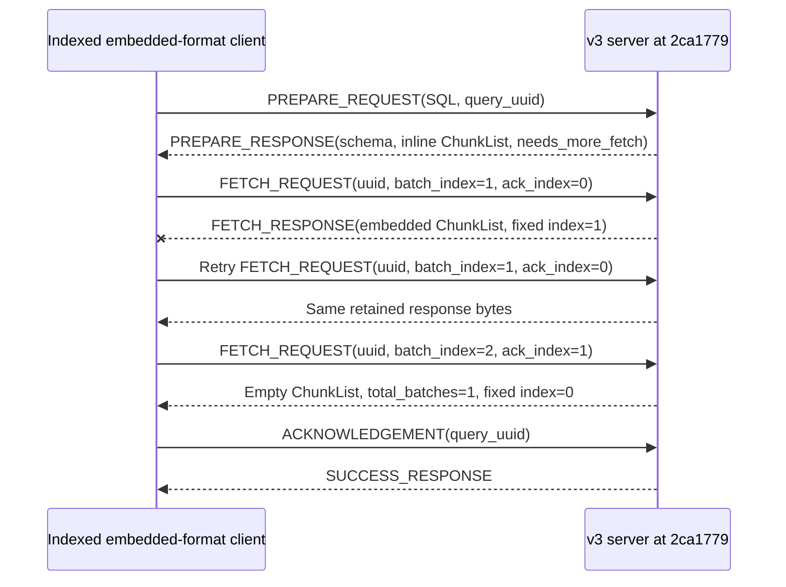
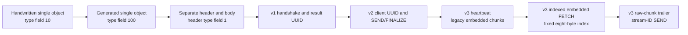

<!--
Copyright (c) 2026 ADBC Drivers Contributors

Licensed under the Apache License, Version 2.0 (the "License");
you may not use this file except in compliance with the License.
You may obtain a copy of the License at

        http://www.apache.org/licenses/LICENSE-2.0

Unless required by applicable law or agreed to in writing, software
distributed under the License is distributed on an "AS IS" BASIS,
WITHOUT WARRANTIES OR CONDITIONS OF ANY KIND, either express or implied.
See the License for the specific language governing permissions and
limitations under the License.
-->

# Quack protocol: independent client reference

This document describes the messages and behavior needed to implement a Quack client without linking DuckDB. Read it together with [DuckDB binary encoding](DUCKDB_BINARY_ENCODING.md), which specifies the serialization of fields, types, values, and result chunks. All diagrams use Mermaid.

**A Quack version number does not uniquely identify a wire format.** The local history contains versions 1, 2, and 3, with incompatible changes inside versions 2 and 3. Select a revision-specific profile before encoding requests. Successful version negotiation alone does not prove that the payload schemas agree.

## Contents

- [Scope and evidence](#scope-and-evidence)
- [Current wire format](#current-wire-format)
- [Current message catalogue](#current-message-catalogue)
- [Current message fields](#current-message-fields)
- [Transport and authentication](#transport-endpoint-selection-and-authentication-current-v3)
- [Query execution and fetching](#query-execution-and-result-consumption-current-v3)
- [Uploading data](#uploading-data-through-sql-current-v3)
- [Transactions](#transactions-and-session-state-current-v3)
- [Heartbeats, cancellation, and disconnect](#heartbeats-cancellation-and-disconnect-current-v3)
- [Errors, retries, and retention](#errors-retries-and-retained-results-current-v3)
- [Historical profiles and field differences](#historical-protocol-families-and-compatibility)
- [Unversioned prototypes](#archival-unversioned-protocol-appendix)
- [Client implementation and validation checklist](#client-implementation-and-validation-checklist)

## Scope and evidence

Research date: **2026-10-21**. “Current” in this document means the inspected local source, not a claim about every installed Quack extension.

| Component | Revision | Role |
|---|---|---|
| Quack main checkout | [`f96420ed46aee9c42064bdb99ddfd1230d6c0086`](https://github.com/duckdb/duckdb-quack/tree/f96420ed46aee9c42064bdb99ddfd1230d6c0086) | Baseline for the complete current reference; advertises Quack version 3 |
| DuckDB dependency pinned by that Quack revision | [`8d68e6f9d887761bf4e4ff6ace906ca6de79d90d`](https://github.com/duckdb/duckdb/tree/8d68e6f9d887761bf4e4ff6ace906ca6de79d90d) | Authoritative binary encoding and type implementation for this baseline |
| Sibling DuckDB checkout | [`a2353736a58acd17f0ba8fae400068ffbf9d465e`](https://github.com/duckdb/duckdb/tree/a2353736a58acd17f0ba8fae400068ffbf9d465e) | Additional local research source; not substituted for the pinned dependency |
| DuckDB 2.0 release branch, `origin/v2.0-cyanoptera` | [`d54cbbe3df17e8e5ce68312f483b4155836112aa`](https://github.com/duckdb/duckdb/tree/d54cbbe3df17e8e5ce68312f483b4155836112aa) | Separately audited engine snapshot; its build configuration selects the same Quack `f96420ed…` revision |
| Local `origin/v1.5-variegata` | [`7e80f7ffcc98d0b3e81d0e1df8cc1c2da240a64b`](https://github.com/duckdb/duckdb-quack/tree/7e80f7ffcc98d0b3e81d0e1df8cc1c2da240a64b) | Maintained version-1 profile |

The evidence order is: generated serialization/deserialization code and hand-written payload encoding; server/client handlers; tests; schema JSON; prose documentation. In particular, a historical JSON schema can lag the generated codec. A source-derived behavior is an observation about that revision, not a promised future protocol guarantee. Client recommendations below are identified as such.

Useful documentation and its limits:

- The [official overview](https://duckdb.org/docs/current/quack/overview), [SQL/settings reference](https://duckdb.org/docs/current/quack/reference), [security guide](https://duckdb.org/docs/current/quack/security), and [announcement](https://duckdb.org/2026/05/12/quack-remote-protocol) explain usage and design. The inspected overview describes the DuckDB 1.5.3 beta; it is not a complete byte-level specification.
- The repository [README](https://github.com/duckdb/duckdb-quack/blob/f96420ed46aee9c42064bdb99ddfd1230d6c0086/README.md) is useful for current usage. [docs/usage.md](https://github.com/duckdb/duckdb-quack/blob/f96420ed46aee9c42064bdb99ddfd1230d6c0086/docs/usage.md) mixes newer features with old `rpc_*` names and `/rpc`; the current route is `/quack`.
- Public prose calls the serialization MIME type `application/duckdb`; the inspected server actually responds with `application/vnd.duckdb`. Use the implementation-specific transport description below.
- `duckdb-quack/rpc.pdf` is a one-page transport benchmark plot, not a protocol specification.

The current field tables are transcribed from [the generated codec](https://github.com/duckdb/duckdb-quack/blob/f96420ed46aee9c42064bdb99ddfd1230d6c0086/src/serialize_quack_message.cpp). Message IDs and the advertised version come from [quack_message.hpp](https://github.com/duckdb/duckdb-quack/blob/f96420ed46aee9c42064bdb99ddfd1230d6c0086/src/include/quack_message.hpp#L16). Raw chunk framing comes from [quack_message.cpp](https://github.com/duckdb/duckdb-quack/blob/f96420ed46aee9c42064bdb99ddfd1230d6c0086/src/quack_message.cpp#L114).

### DuckDB 2.0 branch coverage

The local `v2.0-cyanoptera` snapshot was checked separately on 2026-10-21. Its [out-of-tree Quack configuration](https://github.com/duckdb/duckdb/blob/d54cbbe3df17e8e5ce68312f483b4155836112aa/.github/config/extensions/quack.cmake) selects **Quack `f96420ed46aee9c42064bdb99ddfd1230d6c0086` with no patch list**, exactly the extension source used by the current reference. Thus this release branch uses **Quack wire version 3**, not wire version 2. The engine is the release-branch DuckDB; Quack's nested DuckDB gitlink describes a different build direction and does not override that engine.

Source comparison found no changes to the documented concrete-value serializer, type metadata, chunk, or vector wire schemas between the primary DuckDB revision and this branch snapshot. The current message tables and sequence diagrams apply with the configured extension. See [the encoding companion's branch audit](DUCKDB_BINARY_ENCODING.md#11-duckdb-20-branch-comparison) for null-handling, VARIANT, and validation fixes that can change result values or errors without changing the wire grammar. This conclusion is source-derived; the branch/extension combination was not built or exercised against a client during the audit.

DuckDB's HTTP retry infrastructure also changes on this branch, but its [idempotence check](https://github.com/duckdb/duckdb/blob/d54cbbe3df17e8e5ce68312f483b4155836112aa/src/main/http/http_util.cpp#L149-L151) still excludes POST from automatic replay, and the selected Quack source explicitly disables generic transport retries. The retry distinctions below still apply; no exactly-once PREPARE guarantee follows from using DuckDB 2.0.

## Current wire format

### HTTP body grammar

One HTTP request carries one request message; its HTTP response carries one response message. Quack itself does not add a length-prefixed packet envelope around the HTTP body:

```text
ordinary message = HeaderObject BodyObject
FETCH_RESPONSE   = HeaderObject FetchBodyObject DataChunkObject * chunk_count
SEND_DATA_REQUEST= HeaderObject SendBodyObject  DataChunkObject * chunk_count

Object           = schema-ordered fields, followed by uint16 0xffff
Field            = native uint16 field_id, followed by schema-defined value
```

`* chunk_count` above means exactly that many consecutive chunk objects, not a serialized list, byte-string length, or repeated pointer wrapper. The HTTP message length delimits the whole exchange. Each chunk has its own object terminator. There is no Arrow IPC stream, JSON envelope, protocol-version prefix, or 256-byte padding block in the transmitted body. The implementation's 256-byte reserved header space is an internal allocation technique; unused bytes are excluded from the HTTP response.

Fields are **ordered and schema-dependent**, not a generic tagged format with lengths that permit arbitrary unknown-field skipping. A decoder must know the profile and each field's type. Object terminators are structural: `ff ff` may occur inside a string or raw data, so scanning for this byte pair is not a valid decoder. See the [encoding companion](DUCKDB_BINARY_ENCODING.md) for the full grammar and platform assumptions.

Current Quack pins DuckDB serialization compatibility to `StorageVersion::V2_0_0` for messages and raw chunks. This is separate from `QUACK_VERSION = 3`. [Encoding and payload construction source](https://github.com/duckdb/duckdb-quack/blob/f96420ed46aee9c42064bdb99ddfd1230d6c0086/src/quack_message.cpp#L114).

### Notation used in the tables

| Notation | Meaning on the wire |
|---|---|
| `u8`, `u64` | Unsigned LEB128 value of that width; `idx_t` is `u64` |
| `bool` | One byte, `00` or `01` |
| `string` | Unsigned 32-bit LEB128 byte length followed by bytes |
| `hugeint` | Signed 64-bit LEB128 upper half, then unsigned 64-bit LEB128 lower half |
| `optional_idx` | Unsigned 64-bit LEB128; `UINT64_MAX` denotes unset, otherwise an index/count |
| `list<T>` | Unsigned 64-bit LEB128 element count, then encoded elements |
| `LogicalType` | A serialized type object; see the companion |
| `ptr<T>` | Boolean presence byte, followed by `T` when present |
| `map<string,string>` | Count followed by entry objects containing field 0 key and field 1 value |
| **Required** | The decoder explicitly reads this field; it must be emitted even if its value is zero/unset |
| **Default X** | The decoder supplies X when this field is absent; the normal serializer omits it when equal to X |

Table rows give serialization order. Field names are explanatory and do **not** appear in binary bodies. Defaults describe decoding, not whether the server accepts the resulting request: for example, an omitted heartbeat timeout decodes to zero and the handshake rejects it.

Quack query UUIDs use DuckDB's `hugeint_t` representation, not 16 RFC-4122 network-order bytes and not UUID strings. Follow the companion's UUID conversion rules when starting from a conventional UUID library. Fresh nonzero IDs are recommended; some cache behavior requires nonzero IDs.

## Current message catalogue

| ID | Message | Direction | Normal response / purpose |
|---|---|---|---|
| 1 | `CONNECTION_REQUEST` | Client → server | `CONNECTION_RESPONSE`; authenticate and open logical session |
| 2 | `CONNECTION_RESPONSE` | Server → client | Session ID in header; selected version and lease in body |
| 3 | `PREPARE_REQUEST` | Client → server | `PREPARE_RESPONSE`; **execute** SQL and obtain schema/inline rows |
| 4 | `PREPARE_RESPONSE` | Server → client | Result metadata, optional rows, more-fetch flag |
| 7 | `FETCH_REQUEST` | Client → server | `FETCH_RESPONSE`; obtain a named result batch |
| 8 | `FETCH_RESPONSE` | Server → client | Raw chunks, or terminal empty response |
| 9 | `SEND_DATA_REQUEST` | Client → server | `SEND_DATA_RESPONSE`; deliver data to a registered input stream |
| 10 | `SUCCESS_RESPONSE` | Server → client | Empty success body for control operations |
| 11 | `DISCONNECT_MESSAGE` | Client → server | `SUCCESS_RESPONSE`; close logical session |
| 12 | `CANCEL_REQUEST` | Client → server | `SUCCESS_RESPONSE`; interrupt current query |
| 14 | `SEND_DATA_RESPONSE` | Server → client | Upload acceptance; not final SQL statement success |
| 15 | `ACKNOWLEDGEMENT` | Client → server | `SUCCESS_RESPONSE`; release retained whole-query cache |
| 16 | `HEARTBEAT_REQUEST` | Client → server | `SUCCESS_RESPONSE`; renew session lease |
| 100 | `ERROR_RESPONSE` | Server → client | Application/decoding error instead of a normal response |

ID 0 is `INVALID`; gaps are not available extension points. In particular, historical ID 13 (`FINALIZE_REQUEST`) is not supported by the current server. Only the client-to-server messages listed above are accepted as requests. All requests except connection establishment require an existing session. [Dispatch rules](https://github.com/duckdb/duckdb-quack/blob/f96420ed46aee9c42064bdb99ddfd1230d6c0086/src/quack_server.cpp#L486).

## Current message fields

### Shared header

The header is a complete object before the body, including its own terminator. [Header codec](https://github.com/duckdb/duckdb-quack/blob/f96420ed46aee9c42064bdb99ddfd1230d6c0086/src/serialize_quack_message.cpp#L132).

| ID | Field | Encoding | Presence | Meaning |
|---|---|---|---|---|
| 1 | `type` | `u8` | Required | Message ID from the catalogue |
| 2 | `connection_id` | `string` | Default `""` | Server-issued opaque session ID |
| 3 | `client_query_id` | `optional_idx` | **Required** | Optional-value diagnostic correlation ID; encode the unset sentinel if unused |

The connection request normally omits field 2. Copy the nonempty connection ID from the **connection response header** into every later request. Ordinary response constructors generally have an empty connection ID and unset `client_query_id`; do not require responses to echo request headers. Correlate responses using their HTTP exchanges. The numeric `client_query_id` is distinct from a query UUID and an upload stream ID.

### CONNECTION_REQUEST (1)

[Codec](https://github.com/duckdb/duckdb-quack/blob/f96420ed46aee9c42064bdb99ddfd1230d6c0086/src/serialize_quack_message.cpp#L32) and [handshake validation](https://github.com/duckdb/duckdb-quack/blob/f96420ed46aee9c42064bdb99ddfd1230d6c0086/src/quack_server.cpp#L614).

| ID | Field | Encoding | Presence | Meaning |
|---|---|---|---|---|
| 1 | `auth_string` | `string` | Default `""` | Token/input to configured authentication function |
| 2 | `client_duckdb_version` | `string` | Default `""` | Informational client DuckDB version |
| 3 | `client_platform` | `string` | Default `""` | Informational client platform |
| 4 | `min_supported_quack_version` | `u64` | Default `0` | Inclusive minimum protocol version |
| 5 | `max_supported_quack_version` | `u64` | Default `0` | Inclusive maximum protocol version |
| 6 | `client_id` | `string` | Default `""` | Optional stable logical-client identity input |
| 7 | `heartbeat_timeout_seconds` | `u64` | Default `0` | Requested positive session lease in seconds |

For this profile send minimum = maximum = 3 and a timeout in `1..9223372036854775` (`INT64_MAX / 1000`). The server supports exactly version 3 and checks that it lies in the supplied range; it does not pick an arbitrary lower version. It validates the lease before authentication. No DuckDB-version/platform equality check is performed by this handler, so those strings cannot establish encoding compatibility. An independent client may omit them; do not pretend that a made-up DuckDB version negotiates a format.

### CONNECTION_RESPONSE (2)

[Codec](https://github.com/duckdb/duckdb-quack/blob/f96420ed46aee9c42064bdb99ddfd1230d6c0086/src/serialize_quack_message.cpp#L54).

| ID | Field | Encoding | Presence | Meaning |
|---|---|---|---|---|
| 1 | `server_duckdb_version` | `string` | Default `""` | Informational server version |
| 2 | `server_platform` | `string` | Default `""` | Informational server platform |
| 3 | `quack_version` | `u64` | Default `0` | Selected version; 3 for the current server |
| 4 | `heartbeat_timeout_seconds` | `u64` | Default `0` | Accepted lease, currently echoes the request |

Require a supported selected version, a usable lease, and the session ID from the header before issuing session requests. The reference client explicitly checks the selected version; a decoder accepting absent/default fields does not make an incomplete handshake usable.

### PREPARE_REQUEST (3)

[Codec](https://github.com/duckdb/duckdb-quack/blob/f96420ed46aee9c42064bdb99ddfd1230d6c0086/src/serialize_quack_message.cpp#L146).

| ID | Field | Encoding | Presence | Meaning |
|---|---|---|---|---|
| 1 | `sql_query` | `string` | Default `""` | SQL text to execute |
| 2 | `query_uuid` | `hugeint` | Required | Client-generated identity of this execution |
| 3 | `inline_rows` | `optional_idx` | Default unset | Requested inline-row threshold; zero returns after binding |

There is no separate current wire EXECUTE or bind-parameters message. PREPARE starts execution and replaces the previous active statement on that session. A repeated PREPARE with the same UUID can execute again. Inline rows are a threshold evaluated at batch boundaries, not a strict output-row cap; omitted uses the server setting. For statements waiting for client-uploaded data, explicitly encode `inline_rows=0` so PREPARE can return before input arrives.

### PREPARE_RESPONSE (4)

The Rust codec decodes metadata and inline INTEGER chunks using `duckdb-wiredata`. `PrepareResponse::from_body` validates shared body bytes and exposes immutable metadata and chunk accessors while retaining the original allocation for byte-preserving re-encoding. FETCH payload decoding validates the declared number of bare chunks and rejects trailing bytes. INTEGER values support flat, constant, dictionary, and sequence encodings; unsupported value types produce explicit errors. Constructor error offsets are body-relative; message decoder errors are relative to the complete message.

The Rust query state machine delivers inline chunks before scheduling sequential FETCH requests, validates schemas, UUIDs, indices, and terminal totals, and sends a best-effort whole-query acknowledgement before releasing the session. `quack-tokio::Connection::execute` returns an owned query handle with schema accessors and incremental `next_chunk` delivery. Abandoning an unfinished query disconnects the session. The ADBC driver exposes this through a streaming Arrow reader and the integer statement option `quack.inline_rows` (unset uses the server default, zero forces FETCH, positive values request inline rows).

HTTP response bodies and decoded chunk buffers share immutable byte ownership. On little-endian hosts, aligned flat INTEGER value blobs and flat validity bitmaps become Arrow buffers directly. Unaligned values, big-endian conversion, and compressed vectors materialize directly into final Arrow buffers. The zero-copy boundary starts at the completed HTTP response body; HTTP aggregation can allocate or copy. Retaining an Arrow buffer can retain the entire response allocation, even after the query and session have been destroyed.

[Codec](https://github.com/duckdb/duckdb-quack/blob/f96420ed46aee9c42064bdb99ddfd1230d6c0086/src/serialize_quack_message.cpp#L160).

| ID | Field | Encoding | Presence | Meaning |
|---|---|---|---|---|
| 1 | `result_types` | `list<LogicalType>` | Default empty | Positional result-column types |
| 2 | `result_names` | `list<string>` | Default empty | Positional result-column names; duplicates are possible |
| 3 | `needs_more_fetch` | `bool` | Default `false` | Whether to issue FETCH requests after consuming inline rows |
| 4 | `results` | `list<ptr<DataChunkWrapper>>` | Default empty | Inline result chunks |
| 5 | `query_uuid` | `hugeint` | Required | Result execution identity used by FETCH/CANCEL/ACK |

Each present `DataChunkWrapper` is an object with **required field 300 containing a DataChunk object**. Its list element starts with the non-null pointer byte `01`; the wrapper and nested chunk each have a terminator. This differs from the bare chunks after FETCH/SEND bodies:

```text
PREPARE field 4:
  field-id(4), list-count,
  [presence=1, field-id(300), DataChunkObject, wrapper-terminator] ...

FETCH appended payload:
  DataChunkObject DataChunkObject ...
```

Names are metadata, not unique identifiers. An independent client can preserve duplicate names while addressing columns by position. [Wrapper codec](https://github.com/duckdb/duckdb-quack/blob/f96420ed46aee9c42064bdb99ddfd1230d6c0086/src/quack_message.cpp#L371); the reference DuckDB table function renames duplicates only to satisfy its own binder.

**Upload-readiness exception:** a statement waiting for client data can return PREPARE before final result binding. Its result names/types can therefore be empty even though later FETCH returns data. Registration of the input stream is enough to unblock PREPARE. Decode the types embedded in fetched chunks; FETCH does not provide a later column-name list, so do not invent names from chunk metadata. [Binding/readiness conditions](https://github.com/duckdb/duckdb-quack/blob/f96420ed46aee9c42064bdb99ddfd1230d6c0086/src/include/quack_fetch_collector.hpp#L55-L75), [response construction](https://github.com/duckdb/duckdb-quack/blob/f96420ed46aee9c42064bdb99ddfd1230d6c0086/src/quack_server.cpp#L703-L783).

### FETCH_REQUEST (7)

[Codec](https://github.com/duckdb/duckdb-quack/blob/f96420ed46aee9c42064bdb99ddfd1230d6c0086/src/serialize_quack_message.cpp#L95).

| ID | Field | Encoding | Presence | Meaning |
|---|---|---|---|---|
| 1 | `query_uuid` | `hugeint` | Required | Execution to fetch |
| 2 | `batch_index` | `u64` | Default `0` | Requested dense 1-based batch index; **0 is rejected** |
| 3 | `ack_index` | `u64` | Default `0` | Highest contiguous received index; all batches `1..ack_index` may be released |

Indices start after the inline PREPARE portion. Increment by batch, not row or chunk. Multiple chunks can belong to one batch. Retry the same batch index after a transport failure; do not increment the index for the retry. Only acknowledge data safely retained by the client, and never retry a batch after acknowledging it.

### FETCH_RESPONSE (8)

[Codec](https://github.com/duckdb/duckdb-quack/blob/f96420ed46aee9c42064bdb99ddfd1230d6c0086/src/serialize_quack_message.cpp#L109).

| ID | Field | Encoding | Presence | Meaning |
|---|---|---|---|---|
| 1 | `chunk_count` | `u64` | Default `0` | Number of bare chunk objects after the body |
| 2 | `total_batches` | `optional_idx` | Default unset | Terminal total, excluding PREPARE-inline batches |
| 3 | `batch_index` | `optional_idx` | Default unset | Index of the nonempty response batch |

A data response contains `chunk_count>0`, a valid matching `batch_index`, and appended chunks. A terminal response contains zero chunks and ordinarily a valid `total_batches`; its batch index is unset. It answers a request beyond the result's last batch. Zero `total_batches` is valid for an empty fetched portion and is distinct from unset. Wait for all earlier in-flight batches even if the terminal response arrives first. The current client tolerates an absent total; when supplied, it checks completeness. See the lifecycle section for the exact fetch algorithm.

### SEND_DATA_REQUEST (9)

[Codec](https://github.com/duckdb/duckdb-quack/blob/f96420ed46aee9c42064bdb99ddfd1230d6c0086/src/serialize_quack_message.cpp#L179).

| ID | Field | Encoding | Presence | Meaning |
|---|---|---|---|---|
| 1 | `stream_id` | `string` | Default `""` | Input stream registered by the prepared SQL statement |
| 2 | `chunk_count` | `u64` | Default `0` | Bare appended chunk count |
| 3 | `total_batches` | `optional_idx` | Default unset | Final number of data batches; set on terminal message |
| 4 | `batch_index` | `optional_idx` | Default unset | Dense 1-based data batch index |

The normal client sends data messages with a valid index, one or more chunks, and no total. It finishes with a separate chunk-less message carrying `total_batches=N` and no batch index. An empty upload sends only the terminal `N=0` message after stream registration. Session + stream ID identify the target; there is no query UUID field in this current body.

The server currently accepts a total in a message that also contains chunks, but the reference sender uses the separate terminal message described above. Encoding a zero-chunk message without a total does not finish the stream. These are handler observations, not alternate recommended upload sequences.

### SEND_DATA_RESPONSE (14)

[Codec](https://github.com/duckdb/duckdb-quack/blob/f96420ed46aee9c42064bdb99ddfd1230d6c0086/src/serialize_quack_message.cpp#L196).

| ID | Field | Encoding | Presence | Meaning |
|---|---|---|---|---|
| 1 | `accept_budget` | `optional_idx` | **Required** | Reserved flow-control hint; current server sends unset, meaning unbounded |

Do not omit the field merely because its value is unset. Do not interpret the unset sentinel as a literal allocation or byte credit. This response acknowledges the upload operation; FETCH still obtains the SQL statement's result and any later execution error.

### CANCEL_REQUEST (12)

[Codec](https://github.com/duckdb/duckdb-quack/blob/f96420ed46aee9c42064bdb99ddfd1230d6c0086/src/serialize_quack_message.cpp#L22).

| ID | Field | Encoding | Presence | Meaning |
|---|---|---|---|---|
| 1 | `query_uuid` | `hugeint` | Required | Current query to cancel; `{upper=0, lower=0}` is a wildcard |

An explicit UUID prevents cancellation of a different active query; a mismatch produces an error. A wildcard cancels whichever query is active on the session. The success response does not contain the interrupted query's results.

### ACKNOWLEDGEMENT (15)

[Codec](https://github.com/duckdb/duckdb-quack/blob/f96420ed46aee9c42064bdb99ddfd1230d6c0086/src/serialize_quack_message.cpp#L12).

| ID | Field | Encoding | Presence | Meaning |
|---|---|---|---|---|
| 1 | `query_uuid` | `hugeint` | Default `{0,0}` | Query whose retained result cache can be released |

This is a whole-query acknowledgement, separate from `FETCH_REQUEST.ack_index`. No cache is a successful no-op; a cache for another UUID produces an error. Zero is **not** a wildcard for ACK. The reference client treats failure of this cleanup after successful result consumption as best effort.

### ERROR_RESPONSE (100)

[Codec](https://github.com/duckdb/duckdb-quack/blob/f96420ed46aee9c42064bdb99ddfd1230d6c0086/src/serialize_quack_message.cpp#L78) and [error reconstruction](https://github.com/duckdb/duckdb-quack/blob/f96420ed46aee9c42064bdb99ddfd1230d6c0086/src/quack_message.cpp#L188).

| ID | Field | Encoding | Presence | Meaning |
|---|---|---|---|---|
| 1 | `message` | `string` | Default `""` | Raw error message text |
| 2 | `exception_type` | `string` | Default `""` | DuckDB exception type name, e.g. `Catalog` |
| 3 | `extra_info` | `map<string,string>` | Default empty | Transferable diagnostic metadata |
| 4 | `must_invalidate` | `bool` | Default `false` | Server database is unusable; stop using the connection |

These are structured error fields, not JSON encoded inside field 1. Historical profiles differ. The current implementation filters reserved or process-specific keys (`exception_type`, `exception_message`, `position`, `stack_trace`, `stack_trace_pointers`). It downgrades remote database-fatal exception categories before raising them locally, preserving `original_exception_type` in metadata. An independent client should preserve the remote diagnosis without treating it as corruption of its own process or local database.

An ERROR_RESPONSE may replace any normal response, including during authentication and decoding. HTTP success alone does not mean Quack success. `must_invalidate=false` does not promise that the query or transaction can continue; it only avoids the server-database-invalid verdict.

### Empty-body messages

`SUCCESS_RESPONSE` (10), `DISCONNECT_MESSAGE` (11), and `HEARTBEAT_REQUEST` (16) have **zero body fields**, but still have a body object terminator. A complete message is not just its header. Disconnect and heartbeat require the session ID in the header; both normally receive SUCCESS_RESPONSE.

## Transport, endpoint selection, and authentication (current v3)

Quack carries one request and one response per HTTP `POST /quack`. The payload is binary DuckDB serialization; it is neither JSON nor Arrow IPC. Use `Content-Type: application/vnd.duckdb`, the media type used by the pinned HTTPS client and server responses. HTTP frames the complete message; no WebSocket upgrade or persistent bidirectional application stream is involved. A server can keep HTTP sockets alive, and a logical Quack connection can use multiple HTTP sockets concurrently. The connection ID in the Quack header identifies the session; the socket does not. [`quack_http_server.cpp`](https://github.com/duckdb/duckdb-quack/blob/f96420ed46aee9c42064bdb99ddfd1230d6c0086/src/quack_http_server.cpp#L237-L275), [`quack_client.cpp`](https://github.com/duckdb/duckdb-quack/blob/f96420ed46aee9c42064bdb99ddfd1230d6c0086/src/quack_client.cpp#L255-L294)

The server also provides a human-readable `GET /` response. Browser preflight `OPTIONS /quack` returns HTTP 204 and permits any origin, methods `GET, POST, OPTIONS`, and any request headers; POST responses include `Access-Control-Allow-Origin: *`. These are HTTP conveniences, not additional Quack message types. [`HTTP routes`](https://github.com/duckdb/duckdb-quack/blob/f96420ed46aee9c42064bdb99ddfd1230d6c0086/src/quack_http_server.cpp#L237-L257)

### URI and TLS behavior

The extension accepts `quack:host[:port]` and `quack://host[:port]`; port defaults to **9494**. IPv6 addresses use brackets, for example `quack:[::1]:9494`. It constructs `http://host:port/quack` or `https://host:port/quack`; TLS selection is separate from the `quack:` scheme. Normal SQL entrypoints default to plaintext for `localhost`, `127.0.0.1`, and `::1`, and TLS elsewhere; explicit `disable_ssl` overrides this selection. An independent client can expose explicit transport configuration instead of reproducing SQL secret/URI resolution. [`URI parser`](https://github.com/duckdb/duckdb-quack/blob/f96420ed46aee9c42064bdb99ddfd1230d6c0086/src/quack_uri.cpp#L45-L122), [`local-host classification`](https://github.com/duckdb/duckdb-quack/blob/f96420ed46aee9c42064bdb99ddfd1230d6c0086/src/include/quack_uri.hpp#L49-L52), [`server defaults`](https://github.com/duckdb/duckdb-quack/blob/f96420ed46aee9c42064bdb99ddfd1230d6c0086/src/quack_start_stop.cpp#L81-L88)

Without a pin, the reference client uses DuckDB's HTTP transport and its certificate-verification configuration. With `ssl_fingerprint`, it uses a dedicated OpenSSL client and treats an exact **SHA-256 fingerprint of the server certificate** as the complete trust decision: matching the pin bypasses normal CA-chain and hostname verification; mismatch fails the connection. A pin obtained from a Quack secret enables TLS. Fingerprints normalize to 64 uppercase hexadecimal digits, accepting colon/space separators and an optional `sha256:` prefix. This is a certificate pin, not an SPKI/public-key hash. [`pin verification`](https://github.com/duckdb/duckdb-quack/blob/f96420ed46aee9c42064bdb99ddfd1230d6c0086/src/quack_client.cpp#L212-L242), [`fingerprint normalization`](https://github.com/duckdb/duckdb-quack/blob/f96420ed46aee9c42064bdb99ddfd1230d6c0086/src/quack_uri.cpp#L15-L43), [`secret resolution`](https://github.com/duckdb/duckdb-quack/blob/f96420ed46aee9c42064bdb99ddfd1230d6c0086/src/quack_client.cpp#L405-L429)

### Handshake and session credentials

1. Send `CONNECTION_REQUEST` with an empty header connection ID, the token in body `auth_string`, client version/platform strings, supported protocol range, client ID, and desired positive heartbeat timeout.
2. Decode either `CONNECTION_RESPONSE` or `ERROR_RESPONSE`.
3. Check that the selected protocol version is one the client implements. This server speaks exactly **3** and accepts a requested range only when it includes 3; it does not choose the highest version in the intersection of two multi-version implementations.
4. Save the connection ID from the **response header**, plus the accepted heartbeat timeout. Use this ID for every subsequent request and start the lease-renewal worker.

The server checks the protocol range before authentication. It creates a new DuckDB `Connection` after successful authentication. Client/server DuckDB version and platform strings are descriptive in this handler; they are not checked for equality. [`handshake handler`](https://github.com/duckdb/duckdb-quack/blob/f96420ed46aee9c42064bdb99ddfd1230d6c0086/src/quack_server.cpp#L611-L640), [`client handshake validation`](https://github.com/duckdb/duckdb-quack/blob/f96420ed46aee9c42064bdb99ddfd1230d6c0086/src/quack_client.cpp#L433-L454), [`session creation`](https://github.com/duckdb/duckdb-quack/blob/f96420ed46aee9c42064bdb99ddfd1230d6c0086/src/quack_server.cpp#L382-L402)

The token is a Quack body field, not an HTTP bearer-auth header. After connection, the server looks up `connection_id` without resending the token. Treat the returned connection ID as a bearer credential: it authorizes query, fetch, upload, cancel, heartbeat, and disconnect operations for that session. The optional `client_id` is a separate grouping/diagnostic identifier, not a replacement credential or a request to resume an existing session. Nonempty client IDs are locally required by the reference client to have at least four characters; empty means opt out. The server hashes nonempty IDs with its per-server HMAC key. [`dispatch and session lookup`](https://github.com/duckdb/duckdb-quack/blob/f96420ed46aee9c42064bdb99ddfd1230d6c0086/src/quack_server.cpp#L553-L585), [`client ID handling`](https://github.com/duckdb/duckdb-quack/blob/f96420ed46aee9c42064bdb99ddfd1230d6c0086/src/quack_client.cpp#L355-L363), [`server client hash`](https://github.com/duckdb/duckdb-quack/blob/f96420ed46aee9c42064bdb99ddfd1230d6c0086/src/quack_server.cpp#L463-L479)

Authentication and authorization are configurable SQL callbacks. The current authentication call is `function(connection_id, supplied_token, server_token)`; authorization is `function(connection_id, sql_query)` before each PREPARE. NULL, Boolean false, or a callback failure denies access. A VARCHAR authorization result replaces the SQL to execute; another permitted value leaves the original SQL unchanged. The defaults are `quack_check_token` and `quack_nop_authorization`. This differs from stale `rpc_*` names and callback signatures in `docs/usage.md`. [`callback implementation`](https://github.com/duckdb/duckdb-quack/blob/f96420ed46aee9c42064bdb99ddfd1230d6c0086/src/quack_server.cpp#L431-L461), [`authentication/authorization dispatch`](https://github.com/duckdb/duckdb-quack/blob/f96420ed46aee9c42064bdb99ddfd1230d6c0086/src/quack_server.cpp#L627-L660), [`defaults`](https://github.com/duckdb/duckdb-quack/blob/f96420ed46aee9c42064bdb99ddfd1230d6c0086/src/quack_extension.cpp#L145-L148)

The generic HTTP client can load extra HTTP headers from the Quack secret for proxy authentication. The dedicated pinned-client POST path does not apply that header map in this checkout; do not infer that proxy headers and certificate pinning compose in the reference implementation merely from README wording. An independent client can support both explicitly. [`header loading and generic POST`](https://github.com/duckdb/duckdb-quack/blob/f96420ed46aee9c42064bdb99ddfd1230d6c0086/src/quack_client.cpp#L35-L54), [`generic transport`](https://github.com/duckdb/duckdb-quack/blob/f96420ed46aee9c42064bdb99ddfd1230d6c0086/src/quack_client.cpp#L125-L158), [`pinned POST`](https://github.com/duckdb/duckdb-quack/blob/f96420ed46aee9c42064bdb99ddfd1230d6c0086/src/quack_client.cpp#L255-L271)



## Query execution and result consumption (current v3)

### PREPARE is execution

`PREPARE_REQUEST` authorizes and starts SQL execution immediately. It does not create a reusable prepared-statement ID or take a parameter-value list. `query_uuid` identifies the running query/result and is chosen by the client; reusing it does **not** deduplicate SQL execution. A new PREPARE aborts the previous statement and replaces its active result stream. Serialize SQL statements on a session; use separate Quack sessions for independently concurrent queries. FETCH, SEND_DATA, heartbeat, and cancellation can use concurrent requests around the current statement. [`PREPARE handler`](https://github.com/duckdb/duckdb-quack/blob/f96420ed46aee9c42064bdb99ddfd1230d6c0086/src/quack_server.cpp#L646-L712)

Use a fresh nonzero query UUID for each user query. UUID zero is used by reference-client internal catalog/transaction traffic; it has special cache-preservation behavior. The header's optional `client_query_id` is only for log correlation and is not the UUID used by FETCH or CANCEL. For the clearest client contract, submit one SQL statement per PREPARE: although the server calls DuckDB `Query(sql)` and can execute a multi-statement string, it exposes only one result stream, with a special collector for the first statement that returns a result. There is no sequence of result-set messages comparable to a multi-result database API. [`query driver`](https://github.com/duckdb/duckdb-quack/blob/f96420ed46aee9c42064bdb99ddfd1230d6c0086/src/quack_server.cpp#L119-L201), [`UUID/cache distinction`](https://github.com/duckdb/duckdb-quack/blob/f96420ed46aee9c42064bdb99ddfd1230d6c0086/src/quack_server.cpp#L663-L682), [`client query-log ID`](https://github.com/duckdb/duckdb-quack/blob/f96420ed46aee9c42064bdb99ddfd1230d6c0086/src/quack_client.cpp#L72-L94)

The PREPARE response carries result column names/types, inline result chunks, the query UUID, and `needs_more_fetch`. Consume inline chunks before fetched batches. With `needs_more_fetch=false`, no FETCH is needed. With true, fetch until an empty response indicates the end; true can conservatively require one extra empty FETCH. The server avoids reporting false on an errored stream. [`inline response construction`](https://github.com/duckdb/duckdb-quack/blob/f96420ed46aee9c42064bdb99ddfd1230d6c0086/src/quack_server.cpp#L714-L783)

`inline_rows` controls the PREPARE drain: omitted means the server setting, currently **24,576 rows**; zero means do not wait for inline rows. The server drains whole batches, so this is a threshold, not an exact maximum. A positive threshold may make PREPARE wait for batches or completion. Use zero for SQL waiting for client-uploaded data, otherwise client and server can wait for each other. [`inline drain`](https://github.com/duckdb/duckdb-quack/blob/f96420ed46aee9c42064bdb99ddfd1230d6c0086/src/quack_server.cpp#L714-L759), [`default threshold`](https://github.com/duckdb/duckdb-quack/blob/f96420ed46aee9c42064bdb99ddfd1230d6c0086/src/include/quack_settings.hpp#L22)

### Indexed fetching and acknowledgments

For the remainder after PREPARE, request dense batch indices **1, 2, 3, ...**. Each batch can contain multiple chunks and many rows. The batch index is not a chunk index or row offset, and it excludes all batches already returned inline. The server adds its internal inline-batch count to translate the client index. [`FETCH handler`](https://github.com/duckdb/duckdb-quack/blob/f96420ed46aee9c42064bdb99ddfd1230d6c0086/src/quack_server.cpp#L785-L875)

Every request also carries `ack_index`, the largest **contiguous** prefix received safely by the client. If batches 1 and 3 have arrived but 2 has not, acknowledge 1. The server may discard retained data through this index, unless whole-result caching retains it longer. Do not acknowledge a batch that may need retrying. A retry should preserve the originally encoded request, including its index and acknowledgment, and must not race a newer acknowledgment that permits eviction of the requested batch. [`eviction and retained reply lookup`](https://github.com/duckdb/duckdb-quack/blob/f96420ed46aee9c42064bdb99ddfd1230d6c0086/src/quack_server.cpp#L806-L851), [`request encoding and contiguous acknowledgment`](https://github.com/duckdb/duckdb-quack/blob/f96420ed46aee9c42064bdb99ddfd1230d6c0086/src/quack_fetch_ahead.cpp#L201-L246)

A nonempty FETCH response includes the requested batch index. Check it before accepting data. An empty FETCH response terminates fetching and carries `total_batches` when available. This total counts only FETCH batches, excluding PREPARE data. With parallel requests, an empty response can arrive before a lower-numbered data response. Stop scheduling new fetches, drain outstanding requests, and verify that all indices `1..total_batches` were received before declaring success. The current client validates a supplied total after every in-flight request completes. [`response validation`](https://github.com/duckdb/duckdb-quack/blob/f96420ed46aee9c42064bdb99ddfd1230d6c0086/src/quack_fetch_ahead.cpp#L64-L102), [`terminal count handling`](https://github.com/duckdb/duckdb-quack/blob/f96420ed46aee9c42064bdb99ddfd1230d6c0086/src/quack_fetch_ahead.cpp#L253-L267)



### Minimal sequential query algorithm

The following is conceptual pseudocode, not a JSON representation of the wire. `request` encodes the binary message, checks HTTP success, decodes the reply, handles ERROR_RESPONSE, and checks the expected response type.

```text
execute(sql):
    uuid = fresh_nonzero_query_uuid()
    p = request(PREPARE_REQUEST(session, sql, uuid), PREPARE_RESPONSE)
    validate p.query_uuid and schema
    emit p.inline_chunks
    if p.needs_more_fetch:
        index = 1
        while true:
            encoded = encode(FETCH_REQUEST(session, uuid, index, ack=index-1))
            f = request_encoded(encoded, FETCH_RESPONSE)
            if f.chunk_count == 0:
                if f.total_batches is present:
                    require f.total_batches == index - 1
                break
            require f.batch_index is present and f.batch_index == index
            validate and emit f.chunks
            index += 1
    if whole_result_cache_acknowledgments_enabled:
        best_effort request(ACKNOWLEDGEMENT(session, uuid), SUCCESS_RESPONSE)
```

For a streaming application, a failure after rows have been delivered still fails the result; receiving a valid prefix is not proof of successful completion. A transport failure during PREPARE leaves execution outcome uncertain. Do not turn this algorithm into an unconditional retry loop around PREPARE.

## Uploading data through SQL (current v3)

The client constructs the SQL that consumes uploaded data. The server does not infer an INSERT target from a SEND_DATA message. The internal table function `scan_data_from_quack_client(stream_id, prototype, ordered := ...)` registers an incoming stream when it binds; its STRUCT prototype supplies column names and types before any data arrives. It is available in a server-side Quack session, not as a general local upload API. `ordered` defaults to true. [`scan binding`](https://github.com/duckdb/duckdb-quack/blob/f96420ed46aee9c42064bdb99ddfd1230d6c0086/src/quack_scan_from_client.cpp#L66-L110)

For example, to insert two typed columns, send this SQL in PREPARE with `inline_rows=0` and a fresh query UUID:

```sql
INSERT INTO main.events (id, description)
SELECT id, description
FROM scan_data_from_quack_client(
    'client-generated-stream-id',
    NULL::STRUCT(id BIGINT, description VARCHAR),
    ordered := true
);
```

The string stream ID needs to be unique in the current session; use a fresh random identifier and escape it as an SQL string literal. Quote SQL identifiers independently. The reference insert path generates both a stream UUID string and a query UUID, constructs the SQL client-side, and explicitly requests `inline_rows=0`. [`reference insert setup`](https://github.com/duckdb/duckdb-quack/blob/f96420ed46aee9c42064bdb99ddfd1230d6c0086/src/storage/quack_insert.cpp#L66-L90)

Upload sequence:

1. Wait for successful PREPARE; input-stream registration has made the stream available to SEND_DATA. The final result schema can still be pending, and a PREPARE response is not proof that the INSERT finished.
2. Send data with `SEND_DATA_REQUEST(connection_id, stream_id, chunk_count, batch_index)` followed by the raw chunk objects. Batch indices must be dense and 1-based. Use the same column types/order as the prototype.
3. Allow concurrent batches if desired. The receiving buffer deduplicates an already-seen index, including after it was consumed. A retry must send the same content for the same index: this is index deduplication, not payload-content validation.
4. Wait for all data POSTs to finish successfully before closing. Send an empty SEND_DATA with `total_batches=N`, where N is the number of distinct batches, or zero for an empty upload.
5. Read `SEND_DATA_RESPONSE`; then FETCH the statement result using its query UUID. This last step reports the affected-row count and errors that occur after the final upload. Use the regular fetch-completion rules for arbitrary SQL/RETURNING results.

The server finds the stream within the authenticated session, reports an absent stream as an error, and propagates producer/scan errors. The terminal count is checked against the number of distinct batches received; a missing batch must fail instead of producing a partial successful result. The buffer's count check does not independently prove a maliciously sparse set is `1..N`, so an interoperable sender must supply dense indices. [`SEND_DATA handling`](https://github.com/duckdb/duckdb-quack/blob/f96420ed46aee9c42064bdb99ddfd1230d6c0086/src/quack_server.cpp#L876-L925), [`buffer deduplication and finish`](https://github.com/duckdb/duckdb-quack/blob/f96420ed46aee9c42064bdb99ddfd1230d6c0086/src/include/quack_claim_buffer.hpp#L79-L116), [`finish count check`](https://github.com/duckdb/duckdb-quack/blob/f96420ed46aee9c42064bdb99ddfd1230d6c0086/src/include/quack_claim_buffer.hpp#L232-L259), [`reference final upload and FETCH`](https://github.com/duckdb/duckdb-quack/blob/f96420ed46aee9c42064bdb99ddfd1230d6c0086/src/quack_send_data.cpp#L226-L258)

`SEND_DATA_RESPONSE.accept_budget` is currently unset, meaning unbounded for the future protocol-level flow-control mechanism. It is not a negotiated credits protocol today. The server can nevertheless block a SEND_DATA handler while its bounded buffer is full. Keep heartbeat/cancel requests able to run on a separate HTTP connection while data requests wait. Ordered scanning consumes batches by index; `ordered=false` allows ready batches to be consumed without that ordering requirement. [`send response`](https://github.com/duckdb/duckdb-quack/blob/f96420ed46aee9c42064bdb99ddfd1230d6c0086/src/quack_server.cpp#L908-L925), [`buffer capacity wait`](https://github.com/duckdb/duckdb-quack/blob/f96420ed46aee9c42064bdb99ddfd1230d6c0086/src/include/quack_claim_buffer.hpp#L79-L116), [`ordered and unordered scans`](https://github.com/duckdb/duckdb-quack/blob/f96420ed46aee9c42064bdb99ddfd1230d6c0086/src/quack_scan_from_client.cpp#L137-L210)



## Transactions and session state (current v3)

Each successful handshake creates one server DuckDB `Connection`, so session settings and transaction state belong to the Quack connection ID. There are no dedicated BEGIN/COMMIT/ROLLBACK wire messages: send `BEGIN TRANSACTION`, subsequent SQL, and `COMMIT` or `ROLLBACK` through PREPARE and consume their results. The reference attached-catalog client starts a remote transaction lazily and implements commit/rollback as SQL commands over that same connection. [`server session creation`](https://github.com/duckdb/duckdb-quack/blob/f96420ed46aee9c42064bdb99ddfd1230d6c0086/src/quack_server.cpp#L382-L402), [`transaction implementation`](https://github.com/duckdb/duckdb-quack/blob/f96420ed46aee9c42064bdb99ddfd1230d6c0086/src/storage/quack_transaction.cpp#L18-L41), [`command PREPARE/FETCH`](https://github.com/duckdb/duckdb-quack/blob/f96420ed46aee9c42064bdb99ddfd1230d6c0086/src/storage/quack_catalog.cpp#L108-L139)

Finish consuming or explicitly cancel the previous result before sending the next statement; a new PREPARE supersedes the old result even when its SQL is a transaction-control command. A new handshake creates a new session, not a continuation of the old transaction. Treat a lost COMMIT response as an unknown outcome rather than automatically resubmitting the entire transaction. These are client design consequences of the session and PREPARE dispatch behavior, not an additional transaction-recovery protocol.

## Heartbeats, cancellation, and disconnect (current v3)

The handshake requests a lease timeout in seconds. The allowed interval is **1 through floor(INT64_MAX/1000)**; the default reference-client setting is **60 seconds**. The current server echoes the requested timeout after validation. It uses monotonic elapsed time and considers the lease expired at elapsed time greater than or equal to the timeout. [`timeout bound`](https://github.com/duckdb/duckdb-quack/blob/f96420ed46aee9c42064bdb99ddfd1230d6c0086/src/include/quack_message.hpp#L19-L20), [`lease implementation`](https://github.com/duckdb/duckdb-quack/blob/f96420ed46aee9c42064bdb99ddfd1230d6c0086/src/quack_server.cpp#L23-L53), [`default setting`](https://github.com/duckdb/duckdb-quack/blob/f96420ed46aee9c42064bdb99ddfd1230d6c0086/src/quack_extension.cpp#L220-L223)

Supported, structurally valid requests for an existing connection renew the lease after decoding and before message handling. Thus even a request whose handler subsequently reports an application error can renew it. Malformed messages, unsupported message types, and unknown connection IDs do not. A long-running PREPARE or FETCH renews at arrival, not continuously while it executes. Run a heartbeat worker independently of blocked query requests. The reference interval is `(timeout * 1000 / 3)` milliseconds multiplied by random jitter in `[0.8, 1.2]`; failure of one heartbeat attempt does not itself stop future attempts. [`renewal position`](https://github.com/duckdb/duckdb-quack/blob/f96420ed46aee9c42064bdb99ddfd1230d6c0086/src/quack_server.cpp#L553-L585), [`heartbeat scheduling`](https://github.com/duckdb/duckdb-quack/blob/f96420ed46aee9c42064bdb99ddfd1230d6c0086/src/quack_client.cpp#L22-L25), [`heartbeat worker`](https://github.com/duckdb/duckdb-quack/blob/f96420ed46aee9c42064bdb99ddfd1230d6c0086/src/quack_client.cpp#L342-L353)

`HEARTBEAT_REQUEST` has an empty body and expects SUCCESS_RESPONSE. A lease that has expired cannot be revived by a late heartbeat. Expiry invalidates the session and aborts its work; reconnecting requires a fresh handshake and new session state. Explicit `DISCONNECT_MESSAGE` removes the session and returns success. A later request using the removed ID fails session lookup; disconnect is not implemented as an always-successful idempotent operation. Teardown in the reference client stops heartbeats and attempts one best-effort disconnect with a two-second transport timeout. [`expiry and abort`](https://github.com/duckdb/duckdb-quack/blob/f96420ed46aee9c42064bdb99ddfd1230d6c0086/src/quack_server.cpp#L219-L260), [`disconnect handler`](https://github.com/duckdb/duckdb-quack/blob/f96420ed46aee9c42064bdb99ddfd1230d6c0086/src/quack_server.cpp#L641-L645), [`client teardown`](https://github.com/duckdb/duckdb-quack/blob/f96420ed46aee9c42064bdb99ddfd1230d6c0086/src/quack_client.cpp#L325-L340)

`CANCEL_REQUEST` names the query UUID. The all-zero UUID is a wildcard for whichever query is active. A different nonzero UUID fails with ERROR_RESPONSE. Successful cancellation aborts result/upload buffers, interrupts query execution, clears the result cache, and returns SUCCESS_RESPONSE. An outstanding FETCH can independently return an interruption error. Prefer a specific UUID so a delayed cancel does not kill a later query on the same session. [`cancellation handler`](https://github.com/duckdb/duckdb-quack/blob/f96420ed46aee9c42064bdb99ddfd1230d6c0086/src/quack_server.cpp#L927-L950), [`abort propagation`](https://github.com/duckdb/duckdb-quack/blob/f96420ed46aee9c42064bdb99ddfd1230d6c0086/src/quack_server.cpp#L61-L97)



## Errors, retries, and retained results (current v3)

### Error handling

Separate these failure classes in the client API:

| Failure class | Detection | Consequence |
|---|---|---|
| Transport | Network/TLS failure or unsuccessful HTTP status | A request may have reached the server; execution outcome can be uncertain. |
| Malformed/unexpected response | Binary decode fails, wrong message type, inconsistent batch index/count | Fail the operation; do not expose the received prefix as a complete result. |
| Quack application error | Decoded ERROR_RESPONSE, commonly inside HTTP 200 | Surface remote message/type/extra-info and honor `must_invalidate`. |
| Session failure | Invalid/expired connection ID | Existing session cannot be used; a new handshake does not restore old transaction state. |

The server catches decoding and handler exceptions and returns ERROR_RESPONSE; HTTP 200 is therefore not equivalent to query success. The current pinned client insists on HTTP 200; the generic client uses the HTTP utility's success predicate. Every request handler may return ERROR_RESPONSE instead of its normal reply. [`error conversion`](https://github.com/duckdb/duckdb-quack/blob/f96420ed46aee9c42064bdb99ddfd1230d6c0086/src/quack_server.cpp#L511-L532), [`HTTP clients`](https://github.com/duckdb/duckdb-quack/blob/f96420ed46aee9c42064bdb99ddfd1230d6c0086/src/quack_client.cpp#L125-L143), [`expected-message checks`](https://github.com/duckdb/duckdb-quack/blob/f96420ed46aee9c42064bdb99ddfd1230d6c0086/src/include/quack_client.hpp#L29-L44)

ERROR_RESPONSE includes a raw message, exception-type string, extra-info string map, and `must_invalidate`. The latter reports whether the server database is closed/invalidated; the reference client marks its owning connection unusable rather than repeatedly reconnecting to a broken server. Do not convert a remote Internal/Fatal error into corruption of the client process or database. The DuckDB client downgrades database-invalidating remote categories to Invalid Input, retaining the original type as metadata; unknown exception names also become Invalid Input. Transferable metadata excludes `exception_type`, `exception_message`, `position`, `stack_trace`, and `stack_trace_pointers`. An independent client can preserve the remote error category in its own error object without reproducing DuckDB's local exception taxonomy. [`error representation`](https://github.com/duckdb/duckdb-quack/blob/f96420ed46aee9c42064bdb99ddfd1230d6c0086/src/quack_message.cpp#L202-L260), [`server invalidation flag`](https://github.com/duckdb/duckdb-quack/blob/f96420ed46aee9c42064bdb99ddfd1230d6c0086/src/quack_server.cpp#L525-L532), [`connection invalidation contract`](https://github.com/duckdb/duckdb-quack/blob/f96420ed46aee9c42064bdb99ddfd1230d6c0086/src/include/quack_client.hpp#L137-L145)

### Retry boundaries

| Request | Retry implications in this implementation |
|---|---|
| CONNECTION_REQUEST | Creates a new session each time; a lost reply may leave an inaccessible session until lease expiry. |
| PREPARE_REQUEST | Not idempotent, even with the same UUID. Repetition can execute writes again and supersedes the active result. |
| FETCH_REQUEST | Same batch can be replayed while retained and while the query/session remains valid. Preserve encoded request and do not acknowledge that batch before a pending retry is resolved. |
| SEND_DATA_REQUEST with data | Same stream/index is deduplicated. Preserve the original batch bytes; a different payload with the same index is not a correction mechanism. |
| Terminal SEND_DATA_REQUEST | Repeating the same total can succeed while the stream still exists; it cannot recover missing batches after close. |
| HEARTBEAT_REQUEST | Repeatable while session is alive; it cannot revive an expired lease. |
| CANCEL_REQUEST | Use the exact UUID and account for intervening query changes; wildcard retry can affect a later query. |
| ACKNOWLEDGEMENT | No retained cache is a successful no-op; a retained different query UUID is an error. |
| DISCONNECT_MESSAGE | A second request generally fails because the session was already removed. |

These properties describe handler semantics, not an automatic retry promise. The generic reference transport explicitly sets `retries=0`. Indexed fetch/upload support safe retry in their stated lifetime, but do not supply exactly-once SQL execution or durable recovery after server restart. [`transport retry setting`](https://github.com/duckdb/duckdb-quack/blob/f96420ed46aee9c42064bdb99ddfd1230d6c0086/src/quack_client.cpp#L146-L158), [`request handlers`](https://github.com/duckdb/duckdb-quack/blob/f96420ed46aee9c42064bdb99ddfd1230d6c0086/src/quack_server.cpp#L611-L973)

### Whole-result cache versus per-fetch acknowledgment

There are two separate acknowledgments:

- FETCH `ack_index` releases already-received **batch prefixes** from ordinary retry retention.
- `ACKNOWLEDGEMENT(query_uuid)` releases the **whole-result cache** when the client has received the completed result.

The `quack_enable_reconnects` setting defaults to false. On the server, enabling it retains the last nonzero-UUID query's served payloads, including inline data. On the client, enabling it causes a best-effort ACKNOWLEDGEMENT after all result scanning completes. A failed final acknowledgment is logged and does not turn a fully received successful result into an error. A mismatched UUID is rejected only if a cache currently exists; no cache means success. [`cache enablement`](https://github.com/duckdb/duckdb-quack/blob/f96420ed46aee9c42064bdb99ddfd1230d6c0086/src/quack_result_cache.cpp#L18-L21), [`retention creation`](https://github.com/duckdb/duckdb-quack/blob/f96420ed46aee9c42064bdb99ddfd1230d6c0086/src/quack_server.cpp#L675-L682), [`ACK handler`](https://github.com/duckdb/duckdb-quack/blob/f96420ed46aee9c42064bdb99ddfd1230d6c0086/src/quack_server.cpp#L951-L967), [`best-effort client ACK`](https://github.com/duckdb/duckdb-quack/blob/f96420ed46aee9c42064bdb99ddfd1230d6c0086/src/quack_scan.cpp#L332-L367)

Retention is bounded independently of the heartbeat lease. Defaults are 100,000 retained rows and a 3,600-second idle cache TTL; zero means unlimited rows/no TTL respectively. A new nonzero-UUID PREPARE clears the previous cache; size excess drops whole-result retention; cancellation/disconnect also clear it. Expiring an unfinished cached stream aborts it rather than reporting a truncated result as complete. [`cache settings`](https://github.com/duckdb/duckdb-quack/blob/f96420ed46aee9c42064bdb99ddfd1230d6c0086/src/quack_extension.cpp#L225-L237), [`size eviction`](https://github.com/duckdb/duckdb-quack/blob/f96420ed46aee9c42064bdb99ddfd1230d6c0086/src/quack_server.cpp#L99-L116), [`TTL behavior`](https://github.com/duckdb/duckdb-quack/blob/f96420ed46aee9c42064bdb99ddfd1230d6c0086/src/quack_result_cache.cpp#L47-L69)

Do not interpret the setting name as a documented session-resumption facility. The current message set contains no reconnect/resume request, and CONNECTION_REQUEST always creates a new server connection. A stable `client_id` does not attach it to an existing result or transaction. The verified v3 wire capability is result retention and explicit release, plus same-session indexed FETCH replay within its retention lifetime. [`current message set`](https://github.com/duckdb/duckdb-quack/blob/f96420ed46aee9c42064bdb99ddfd1230d6c0086/src/include/quack_message.hpp#L22-L38), [`new-session handshake`](https://github.com/duckdb/duckdb-quack/blob/f96420ed46aee9c42064bdb99ddfd1230d6c0086/src/quack_server.cpp#L627-L639)


## Historical protocol families and compatibility

This section specifies historical layouts as differences from the current reference. A negotiated `quack_version` is **not a sufficient wire-format identifier**: versions 1, 2, and 3 each span source changes, and version 3 includes incompatible FETCH and SEND encodings. Pin a client to a known server revision/family; do not infer a format from a successful handshake alone. These family names are documentation labels, not extra on-wire version values.

Dates below are main-branch integration dates where available. Several changes were authored on long-lived branches and merged much later. The repository has no local release tags. The maintained `origin/v1.5-variegata` branch is still protocol 1, despite its July tip date.

### Revision matrix

Each Quack link below identifies immutable source. The DuckDB column is the gitlink recorded by that Quack revision, not the independent local DuckDB checkout. `SC7` and `SC10` mean `SerializationCompatibility::FromIndex(7/10)`; `SV1.5` and `SV2.0` mean `StorageCompatibility::FromIndex(StorageVersion::V1_5_0/V2_0_0)`. These choices affect nested value/chunk serialization independently of the Quack message version.

| Family / source snapshot | Quack revision | DuckDB gitlink | Serialization target |
|---|---|---|---|
| Last handwritten pre-overhaul example | [5466ce6](https://github.com/duckdb/duckdb-quack/tree/5466ce61ef555b44a5015201bdb653a9ab8eefdb) | `8a5851971fae891f292c2714d86046ee018e9737` | SC10 |
| First numbered v1, May 8 | [7a5ee2b](https://github.com/duckdb/duckdb-quack/tree/7a5ee2b21fbca9e52751d286b488868f60854722) | `8a5851971fae891f292c2714d86046ee018e9737` | SC10 |
| Maintained v1 branch, July 20 | [7e80f7f](https://github.com/duckdb/duckdb-quack/tree/7e80f7ffcc98d0b3e81d0e1df8cc1c2da240a64b) | `08e34c447bae34eaee3723cac61f2878b6bdf787` | SC7 |
| Initial v2, June 30 | [3d0369d](https://github.com/duckdb/duckdb-quack/tree/3d0369d710c719ac4fafee031bf4b37f8f37caa7) | `53b829b8f0ea2bce3e874769d181f665d2dbf412` | SV1.5 |
| v2 asynchronous SEND, July 2 | [a6f3f16](https://github.com/duckdb/duckdb-quack/tree/a6f3f16766bf9c91a2bcb6995b21f56cea381ec6) | `53b829b8f0ea2bce3e874769d181f665d2dbf412` | SV1.5 |
| v2 serialization bump, July 7 | [2bb5a01](https://github.com/duckdb/duckdb-quack/tree/2bb5a01ea2d9ee35d321c6e6793fa24e94099115) | `53b829b8f0ea2bce3e874769d181f665d2dbf412` | SV2.0 |
| v2 client identity, July 15 | [cc85eaf](https://github.com/duckdb/duckdb-quack/tree/cc85eafb4db351d07fa6c16ddb3927b918297d09) | `53b829b8f0ea2bce3e874769d181f665d2dbf412` | SV2.0 |
| v2 empty ACK, July 23 | [3328b18](https://github.com/duckdb/duckdb-quack/tree/3328b1805680859f602ef53d4bf1550f4db79c1d) | `26063e4ca7c7cda17af1231de7fdddfcdbde12a2` | SV2.0 |
| v2 UUID ACK/cache, August 11 | [3c843b9](https://github.com/duckdb/duckdb-quack/tree/3c843b949e4acf1d66c80618c9e248eca8717bf8) | `8ca23ace4aa67619adc1e396116c68bd795b9029` | SV2.0 |
| v3 heartbeat, August 14 | [ec4c091](https://github.com/duckdb/duckdb-quack/tree/ec4c091abcf1f6efeb39045ec2bbed5bfb9eaa6b) | `8ca23ace4aa67619adc1e396116c68bd795b9029` | SV2.0 |
| v3 indexed embedded FETCH, August 20 | [2ca1779](https://github.com/duckdb/duckdb-quack/tree/2ca17797acfed0e29187482700db30d0b01a7954) | `e20aeb78111d3cf7df99563498c4e2ed2dd58eee` | SV2.0 |
| v3 raw-chunk FETCH/SEND, August 28 | [8624191](https://github.com/duckdb/duckdb-quack/tree/8624191aa9bf1f1c58eb1c1d71c97117514524ea) | `f1c54da78bf9918465c2603a20879184291082f0` | SV2.0 |
| v3 structured errors, September 14 | [fa3f82c](https://github.com/duckdb/duckdb-quack/tree/fa3f82c53cf587838d55efbd24f31b0c055684a9) | `f1c54da78bf9918465c2603a20879184291082f0` | SV2.0 |
| Audited main tip | [f96420e](https://github.com/duckdb/duckdb-quack/tree/f96420ed46aee9c42064bdb99ddfd1230d6c0086) | `8d68e6f9d887761bf4e4ff6ace906ca6de79d90d` | SV2.0 |

SC10 became SC7 in [83f79cc](https://github.com/duckdb/duckdb-quack/commit/83f79cc39412e1f522a96ca03dd824b841d8432e). The SV1.5 → SV2.0 change is [4d84e8e](https://github.com/duckdb/duckdb-quack/commit/4d84e8e554ca1db33356367ab44967b3d30d1198). Neither is a distinct negotiated Quack version.

### Reading historical field tables

`R` means the generated codec uses `ReadProperty`: the field must be present, even when its value is an invalid `optional_idx`. `D(x)` means the field may be omitted and decodes as `x`. Default strings are empty, containers empty, integers zero, and booleans false unless specified. `D(invalid)` for `optional_idx` explicitly uses the invalid value. `ChunkPtr` means a nullable pointer to `DataChunkWrapper`, whose object contains field **300** holding a nested `DataChunk`; `ChunkList` is a vector of these nullable wrapper objects. This differs from the current raw-chunk trailer. Field names are explanatory; IDs, ordering, types, and object boundaries form the binary contract.

The historical generated `.cpp` files are authoritative over `.json`: for example, [50716f4](https://github.com/duckdb/duckdb-quack/commit/50716f48ab2586d5feabe7ca92f0632659468947) added mandatory PREPARE field 2 in generated C++ without simultaneously updating the JSON schema. A source-derived protocol table must therefore inspect both the codec and its handler.

### Version 1: maintained DuckDB 1.5 branch

This is the complete outer schema at `7e80f7f`. All messages consist of a serialized header object followed by a serialized body object. There is no raw-chunk trailer.

| Object / message ID | Fields in serialization order |
|---|---|
| Header | `1 type: MessageType R`; `2 connection_id: string D("")`; `3 client_query_id: optional_idx R` |
| CONNECTION_REQUEST = 1 | `1 auth_string: string D("")`; `2 client_duckdb_version: string D("")`; `3 client_platform: string D("")`; `4 min_supported_quack_version: idx_t D(0)`; `5 max_supported_quack_version: idx_t D(0)` |
| CONNECTION_RESPONSE = 2 | `1 server_duckdb_version: string D("")`; `2 server_platform: string D("")`; `3 quack_version: idx_t D(0)` |
| PREPARE_REQUEST = 3 | `1 sql_query: string D("")` |
| PREPARE_RESPONSE = 4 | `1 result_types: vector<LogicalType> D([])`; `2 result_names: vector<string> D([])`; `3 needs_more_fetch: bool D(false)`; `4 results: ChunkList D([])`; `5 result_uuid: hugeint_t R` |
| FETCH_REQUEST = 7 | `1 uuid: hugeint_t R` |
| FETCH_RESPONSE = 8 | `1 results: ChunkList D([])`; `2 batch_index: optional_idx R` |
| APPEND_REQUEST = 9 | `1 schema_name: string D("")`; `2 table_name: string D("")`; `3 append_chunk: ChunkPtr D(null)` |
| SUCCESS_RESPONSE = 10 | Empty body object |
| DISCONNECT_MESSAGE = 11 | Empty body object |
| ERROR_RESPONSE = 100 | `1 message: string D("")` |

Message IDs 5 and 6 are unused. Cancellation, SEND, FINALIZE, ACK, and heartbeat messages do not exist in this maintained branch. Connect uses an empty header connection ID; the successful response places the assigned connection ID in its header. Subsequent requests send that ID. An omitted APPEND chunk can decode as null but is not a valid usable append operation. Sources: [enum/classes](https://github.com/duckdb/duckdb-quack/blob/7e80f7ffcc98d0b3e81d0e1df8cc1c2da240a64b/src/include/quack_message.hpp), [complete generated codec](https://github.com/duckdb/duckdb-quack/blob/7e80f7ffcc98d0b3e81d0e1df8cc1c2da240a64b/src/serialize_quack_message.cpp), [wrapper/framing](https://github.com/duckdb/duckdb-quack/blob/7e80f7ffcc98d0b3e81d0e1df8cc1c2da240a64b/src/quack_message.cpp).

**Handshake.** The native client sends `[min,max]=[1,1]`; the server replies `quack_version=1`. This server implementation checks only `minimum > 1`, not whether maximum includes 1. An independent client must validate the response itself. Do not mistake this weak check for real multi-version support. There are no heartbeat leases. Source: [v1 server](https://github.com/duckdb/duckdb-quack/blob/7e80f7ffcc98d0b3e81d0e1df8cc1c2da240a64b/src/quack_server.cpp).

**Queries.** PREPARE executes SQL and returns schema, an initial chunk list, and a fresh **server-generated** result UUID. Treat its inline chunks as the prefix of the result. If `needs_more_fetch=false`, the inline rows are complete. Otherwise send FETCH with that UUID until an empty chunk list arrives. FETCH advances the server cursor; the request does not name a batch and cannot safely be retried after an ambiguous transport failure. Response batches carry increasing indexes starting at 1, allowing parallel responses to be reordered. The terminal response can have an invalid batch index when the cursor was already exhausted. A new PREPARE resets the cursor and UUID; FETCH for the previous result fails. An empty result is not an error.

The v1 `needs_more_fetch` calculation is based on whether PREPARE filled its chunk budget. An exact-budget result may therefore require one extra FETCH to discover exhaustion. Do not infer completion from row count, or assume the last nonempty response announces it. Query or fetch errors arrive as ERROR_RESPONSE instead of data; this historical schema carries only raw message text and reconstructs it as an invalid-input error on the native client.



**Appending.** APPEND supplies schema/table and one self-describing wrapped chunk. The server directly appends it and replies SUCCESS or ERROR. There is no terminal upload message, per-upload UUID, deduplication index, or returned row count. Do not replay an ambiguous APPEND automatically: its effects may already have been applied. Source: [APPEND and query handlers](https://github.com/duckdb/duckdb-quack/blob/7e80f7ffcc98d0b3e81d0e1df8cc1c2da240a64b/src/quack_server.cpp).

### Version 2: client query UUIDs and uploads

The June 30 v2 snapshot `3d0369d` inherits the v1 header, connect, PREPARE response structure, cursor-based FETCH, success/disconnect, and text-only error messages, with these replacements/additions:

| Message | Change from v1 |
|---|---|
| PREPARE_REQUEST = 3 | Add `2 query_uuid: hugeint_t R` |
| PREPARE_RESPONSE = 4 | Field 5 becomes the **client-supplied** `query_uuid`; same `hugeint_t R` encoding |
| SEND_DATA_REQUEST = 9 | Replaces APPEND. `1 schema_name: string D("")`; `2 table_name: string D("")`; `3 append_chunk: ChunkPtr D(null)`; `4 query_uuid: hugeint_t R` |
| CANCEL_REQUEST = 12 | `1 query_uuid: hugeint_t R` |
| FINALIZE = 13 | `1 query_uuid: hugeint_t R` |
| SEND_DATA_RESPONSE = 14 | `1 accept_budget: optional_idx R` |

`accept_budget` is present but normally invalid, meaning no advertised bound; the native client does not use it for flow control. Cancellation identifies the query; all-zero `hugeint_t` is a wildcard for the connection's active query. CANCEL replies SUCCESS or ERROR. The upload UUID identifies the stream together with the connection ID. Sources: [initial v2 generated codec](https://github.com/duckdb/duckdb-quack/blob/3d0369d710c719ac4fafee031bf4b37f8f37caa7/src/serialize_quack_message.cpp), [v2 server](https://github.com/duckdb/duckdb-quack/blob/3d0369d710c719ac4fafee031bf4b37f8f37caa7/src/quack_server.cpp).

**Upload sequence.** The first SEND lazily creates a stream and starts a server-owned INSERT into the specified table. Each SEND queues one chunk and gets SEND_DATA_RESPONSE. After every send has completed, FINALIZE closes the stream, waits for the INSERT, and returns SUCCESS or ERROR. FINALIZE for no matching stream succeeds, covering a zero-chunk insert. This is different from the current protocol's client PREPARE of an INSERT reading an explicit stream ID. There is no independent-client PREPARE before the legacy upload. Initial v2 SEND has no deduplication identifier for each individual chunk.



The version increment itself changes only the version constant and minimum-version rejection check. The client-query-UUID/cancel changes had already appeared on main while it still advertised 1, in [ebf8841](https://github.com/duckdb/duckdb-quack/commit/ebf8841), and SEND before the bump in [3834e20](https://github.com/duckdb/duckdb-quack/commit/3834e20). Thus the stable v1 branch is a clearer target than “any commit reporting 1.” [f117a11](https://github.com/duckdb/duckdb-quack/commit/f117a11) subsequently makes both peers enforce the negotiated version: the server checks both ends of the requested interval, and the client requires its exact version.

### Version 2 asynchronous SEND, retained by initial version 3

At `a6f3f16` the message number stays 9 but its body changes incompatibly. Fields 1, 2, and 4 retain their initial-v2 meanings; field 3 is now a **list** rather than a single nullable chunk wrapper.

An earlier development snapshot, [`0852c7a6d13bd697ead92b8d65c053df6e58772b`](https://github.com/duckdb/duckdb-quack/blob/0852c7a6d13bd697ead92b8d65c053df6e58772b/src/serialize_quack_message.cpp), already has fields 1–8 below and the FINALIZE watermark, but lacks field 9. The `dead_range_end` field is added by [`4fda48d`](https://github.com/duckdb/duckdb-quack/commit/4fda48d). Use the pre-addition schema for that snapshot rather than sending its receiver an unknown field 9.

| ID | SEND_DATA field | Type / default | Meaning |
|---|---|---|---|
| 1 | schema_name | string D("") | Target schema |
| 2 | table_name | string D("") | Target table |
| 3 | chunks | ChunkList D([]) | One fragment of an ordered batch, or unordered chunks |
| 4 | query_uuid | hugeint_t R | Upload identity |
| 5 | batch_index | optional_idx R | Valid selects ordered mode; invalid selects unordered mode |
| 6 | sequence_index | idx_t D(0) | Fragment sequence within an ordered batch |
| 7 | is_last_in_batch | bool D(false) | This fragment completes its ordered batch |
| 8 | batch_watermark | optional_idx D(invalid) | Minimum batch index that will appear; initializes ordered delivery |
| 9 | dead_range_end | optional_idx D(invalid) | With valid field 5 and no chunks, marks half-open dead range `[batch_index, dead_range_end)` |

FINALIZE retains `1 query_uuid: hugeint_t R` and adds `2 min_batch_watermark: optional_idx D(invalid)`. SEND_DATA_RESPONSE is unchanged. Ordered indices describe the producing pipeline's batches and can have gaps; this is not the later dense `1..N` protocol. Send explicit dead-range markers for gaps that will never produce rows, or the ordered consumer can stall. An unordered implementation can avoid these ordering fields semantically by encoding the required field 5 as invalid and leaving fields 6–9 at defaults. The server starts its INSERT on the first data-bearing SEND; a marker can precede that data and be buffered. A zero-chunk first ordinary message does not start the stream. Drain sends before FINALIZE and inspect the final statement outcome. Sources: [codec](https://github.com/duckdb/duckdb-quack/blob/a6f3f16766bf9c91a2bcb6995b21f56cea381ec6/src/serialize_quack_message.cpp), [field semantics](https://github.com/duckdb/duckdb-quack/blob/a6f3f16766bf9c91a2bcb6995b21f56cea381ec6/src/include/quack_message.hpp), [handler](https://github.com/duckdb/duckdb-quack/blob/a6f3f16766bf9c91a2bcb6995b21f56cea381ec6/src/quack_server.cpp).

Later v2 changes that do not change this SEND layout:

| Snapshot | Wire/behavior change |
|---|---|
| `2bb5a01` | Nested serializer target switches to SV2.0 |
| `cc85eaf` | CONNECTION_REQUEST adds `6 client_id: string D("")`; this is client identity material, not an extra connection/session ID |
| `3328b18` | Introduces ACKNOWLEDGEMENT = 15 with an **empty** body; handler returns SUCCESS and does nothing else |
| `3c843b9` | ACK adds `1 query_uuid: hugeint_t D(0)`; acknowledges an entire retained result, checks its UUID when a cache exists, and clears that cache; if no cache exists it succeeds as a no-op |

Sources: [identity codec](https://github.com/duckdb/duckdb-quack/blob/cc85eafb4db351d07fa6c16ddb3927b918297d09/src/serialize_quack_message.cpp), [initial no-op ACK handler](https://github.com/duckdb/duckdb-quack/blob/3328b1805680859f602ef53d4bf1550f4db79c1d/src/quack_server.cpp), [UUID ACK codec](https://github.com/duckdb/duckdb-quack/blob/3c843b949e4acf1d66c80618c9e248eca8717bf8/src/serialize_quack_message.cpp), [cache/ACK handler](https://github.com/duckdb/duckdb-quack/blob/3c843b949e4acf1d66c80618c9e248eca8717bf8/src/quack_server.cpp).

Although the late-v2 server can retain result data, its FETCH wire request still names only the UUID and advances a cursor. The cache feature does not make a lost HTTP FETCH reply safely retryable by batch number. Full-result ACK is also distinct from the later cumulative per-batch `ack_index`.

### Version 3 before indexed FETCH

The heartbeat change increments `QUACK_VERSION` from 2 to 3 in [989e8d4](https://github.com/duckdb/duckdb-quack/commit/989e8d45d70ec51b9f23d9b0f3addaebf03b1340), integrated at `ec4c091`. Relative to late v2, it adds exactly these message fields/types:

| Message | Added field / behavior |
|---|---|
| CONNECTION_REQUEST = 1 | `7 heartbeat_timeout_seconds: idx_t D(0)` |
| CONNECTION_RESPONSE = 2 | `4 heartbeat_timeout_seconds: idx_t D(0)` |
| HEARTBEAT_REQUEST = 16 | Empty body; valid session request renews the logical connection lease and receives SUCCESS |

The timeout's encoding default of zero does not make zero a valid requested lease: the server validates the value. Use the negotiated accepted timeout and maintain the lease as described for current v3. All other messages in this initial v3 snapshot still use the late-v2 layouts above: FETCH has only UUID and embedded chunks; SEND uses schema/table, chunk fragments, watermark/dead-range fields; FINALIZE still exists. Sources: [initial-v3 codec](https://github.com/duckdb/duckdb-quack/blob/ec4c091abcf1f6efeb39045ec2bbed5bfb9eaa6b/src/serialize_quack_message.cpp), [server lease handling](https://github.com/duckdb/duckdb-quack/blob/ec4c091abcf1f6efeb39045ec2bbed5bfb9eaa6b/src/quack_server.cpp).

### Version 3 indexed FETCH with embedded chunks

At `2ca1779`, FETCH becomes an explicitly addressed batch protocol, while SEND remains the legacy watermark form. This is an incompatible FETCH_RESPONSE change under version 3.

The same indexed-request/fixed-eight-byte-response family also appears on a development branch at [`b2941819e188f2e6849b01f3c8caf5e14564af30`](https://github.com/duckdb/duckdb-quack/blob/b2941819e188f2e6849b01f3c8caf5e14564af30/src/serialize_quack_message.cpp) while advertising **version 2**, without heartbeat fields and with the older empty ACK body. Its main-branch integration is the version-3 snapshot above. A historical capture reporting version 2 can therefore already contain this indexed FETCH family.

| Message | Complete replacement body |
|---|---|
| FETCH_REQUEST = 7 | `1 uuid: hugeint_t R`; `2 batch_index: idx_t D(0)`; `3 ack_index: idx_t D(0)` |
| FETCH_RESPONSE = 8 | `1 results: ChunkList D([])`; `2 total_batches: optional_idx D(invalid)`; `3 batch_index_fixed: string D("")` with mandatory semantic length 8 |

The new `batch_index_fixed` is a binary string, not text or a serializer integer: string length 8, followed by eight little-endian bytes. Zero represents an invalid/absent batch index; `0xF1DCBA99C0FFEE42` is an internal unstamped placeholder and is rejected. All responses, including terminal ones, encode an eight-byte field; a decoder that supplies the schema's empty-string default subsequently fails the length check. In data replies, the chunk-list count can use a **five-byte zero-padded LEB128 encoding** because the writer backpatches it; accept non-minimal LEB128 here. The list elements still have the nullable-pointer wrapper and field 300 around each DataChunk. Sources: [generated codec](https://github.com/duckdb/duckdb-quack/blob/2ca17797acfed0e29187482700db30d0b01a7954/src/serialize_quack_message.cpp), [custom payload writer and fixed-index decoder](https://github.com/duckdb/duckdb-quack/blob/2ca17797acfed0e29187482700db30d0b01a7954/src/quack_message.cpp).

Requests must specify positive `batch_index`, starting at 1 **after** the inline PREPARE rows. `ack_index` declares the contiguous prefix of FETCH batches already received; zero acknowledges none. The server retains served bytes until acknowledgement (or longer with full-result caching), permitting an identical outstanding batch to be served again after an HTTP failure. Do not acknowledge a missing batch, or retry a batch after allowing its bytes to be discarded. An empty terminal response reports `total_batches`; with parallel fetches, assemble all batches through that count before accepting completion. This is the same broad client sequence as current indexed fetching, but the response's chunk placement and batch-index field are different. Source: [indexed handler](https://github.com/duckdb/duckdb-quack/blob/2ca17797acfed0e29187482700db30d0b01a7954/src/quack_server.cpp).



### Version 3 development snapshots between indexed FETCH and raw chunks

These commits are locally reachable development history, not separately tagged releases. Their schemas explain why a historical checkout can differ even from both adjacent main snapshots. Treat a full matching build as the compatibility target; an intermediate commit may contain transitional code/comments. The final merged form is `8624191`.

| Commit | Exact wire change |
|---|---|
| [32d9a05](https://github.com/duckdb/duckdb-quack/blob/32d9a0588a541c4f2d2b4cce3769951f5c890877/src/serialize_quack_message.cpp) | SEND body becomes `1 schema_name: string D("")`, `2 table_name: string D("")`, `3 chunks: ChunkList D([])`, `4 query_uuid: hugeint_t R`, `5 ordered: bool D(false)`, `6 batch_index_fixed: string D("")` with the same required eight-byte interpretation. FINALIZE field 2 changes meaning from minimum watermark to `total_batches: optional_idx D(invalid)`. Fragment sequence/dead-range fields disappear. |
| [5244c69](https://github.com/duckdb/duckdb-quack/blob/5244c69fd9cb924f8f2adcdccf69724a7b215502/src/serialize_quack_message.cpp) | PREPARE adds `3 inline_rows: optional_idx D(invalid)`. SEND replaces its body with `1 stream_id: string D("")`, `2 chunks: ChunkList D([])`, `3 total_batches: optional_idx D(invalid)`, `4 batch_index_fixed: string D("")` (eight-byte interpretation). FINALIZE is removed. |
| [902b040](https://github.com/duckdb/duckdb-quack/blob/902b040b864b4288feae26af8c041470a6c82572/src/serialize_quack_message.cpp) | SEND_DATA_RESPONSE adds `2 row_count: optional_idx D(invalid)`; terminal SEND can wait for the statement and carry the affected-row count. |
| [9819433](https://github.com/duckdb/duckdb-quack/blob/9819433d1b4e7eb316c53b9c8a5d8893437c1cab/src/serialize_quack_message.cpp) | Removes SEND response field 2 again; use FETCH to obtain the INSERT statement's count result. |
| [60f8424](https://github.com/duckdb/duckdb-quack/commit/60f8424b20927c783c4d3bdeba1c2d88801bf405) | FETCH/SEND switch from embedded chunk lists and fixed-index strings to the current metadata-body plus raw-chunk trailer format, detailed next. |

At the stream-ID stage, PREPARE must already have bound the SQL statement that registers the stream. SEND rejects an unknown stream or a stream owned by another session. Each data message has one dense positive batch index; duplicate indexed sends are dropped by the receiving buffer. Drain all sends, then send a zero-chunk SEND with `total_batches=N` to close the input. The terminal message closes the stream rather than using removed message 13. Except for the temporary row-count variant, FETCH the INSERT result to observe statement outcome/count. Thus “SEND accepted” and “INSERT succeeded” remain separate events. Sources: [stream-ID handler](https://github.com/duckdb/duckdb-quack/blob/5244c69fd9cb924f8f2adcdccf69724a7b215502/src/quack_server.cpp), [native finish sequence](https://github.com/duckdb/duckdb-quack/blob/9819433d1b4e7eb316c53b9c8a5d8893437c1cab/src/quack_send_data.cpp).

### Version 3 raw chunks and structured errors

The format merged at `8624191` is the current framing family. Relative to the stream-ID embedded snapshot, replace only these message bodies; PREPARE inline `results` remains a wrapped ChunkList.

| Message | Replacement body and following bytes |
|---|---|
| FETCH_RESPONSE = 8 | `1 chunk_count: idx_t D(0)`; `2 total_batches: optional_idx D(invalid)`; `3 batch_index: optional_idx D(invalid)`; then `chunk_count` independent DataChunk objects |
| SEND_DATA_REQUEST = 9 | `1 stream_id: string D("")`; `2 chunk_count: idx_t D(0)`; `3 total_batches: optional_idx D(invalid)`; `4 batch_index: optional_idx D(invalid)`; then `chunk_count` independent DataChunk objects |

The trailer contains **no nullable ChunkPtr markers and no wrapper field 300**. It begins immediately after the message-body object's terminator; internal reserved header space is not sent. The old fixed-width binary string is replaced by normal `optional_idx` encoding. A version-3-only check cannot distinguish these families. Source: [raw-chunk writer/decoder](https://github.com/duckdb/duckdb-quack/blob/8624191aa9bf1f1c58eb1c1d71c97117514524ea/src/quack_message.cpp).

The `fa3f82c` merge retains this data format and extends ERROR_RESPONSE from its sole `1 message: string D("")` field with `2 exception_type: string D("")`, `3 extra_info: unordered_map<string,string> D({})`, and `4 must_invalidate: bool D(false)`. Exception type is a name, not a numeric enum. Missing/unknown names fall back to invalid input in the native client. Internal/fatal errors are mapped so that the remote server's database failure does not invalidate the client's own database. `must_invalidate` separately identifies a server instance that should no longer be used. See the current error-handling section for the complete interpretation. Sources: [structured error codec](https://github.com/duckdb/duckdb-quack/blob/fa3f82c53cf587838d55efbd24f31b0c055684a9/src/serialize_quack_message.cpp), [error construction/filtering](https://github.com/duckdb/duckdb-quack/blob/fa3f82c53cf587838d55efbd24f31b0c055684a9/src/quack_message.cpp).

The October rename of FETCH's `uuid` to `query_uuid` does not alter field 1's ID/type, so it is not another binary format. Likewise, [8822897](https://github.com/duckdb/duckdb-quack/commit/88228979e995ebc69433d3b30c922d7fcb8dbecf) comments out a CI schema/version check; it does **not** disable runtime version negotiation.

## Archival unversioned protocol appendix

These are precursors, not negotiated versions 0 or alternate modes of current Quack. Their messages cannot be sent to the current `/quack` endpoint without a separate codec. The snapshots below identify major format families rather than certifying every exploratory commit as a functioning release. `rpc.pdf` contains benchmark charts, not a protocol specification.

### WebSocket / Unix-socket snapshot before HTTP

The parent of [9f133b7](https://github.com/duckdb/duckdb-quack/commit/9f133b7) uses the handwritten `ProtocolMessage` codec and SC10. Every message is a single serialized object beginning with required field `10 message_type: uint8_t`. The transport is either one binary WebSocket message per request/reply or, for a Unix socket, a native-memory `idx_t` length followed by exactly that many message bytes. That socket length uses host representation rather than the serializer's varint encoding, so a portable implementation must match the host's width and endianness. Source: [pre-HTTP message/socket codec](https://github.com/duckdb/duckdb-quack/blob/012d1d18f153244ac1ded30723aad51df74eafd9/src/message.cpp), [WebSocket response framing](https://github.com/duckdb/duckdb-quack/blob/012d1d18f153244ac1ded30723aad51df74eafd9/src/websocket_rpc_server.cpp).

At that snapshot, after field 10:

| Message | Remaining fields, all required unless conditional |
|---|---|
| CONNECTION_REQUEST = 1 | None; no auth field yet |
| CONNECTION_RESPONSE = 2 | `98 connection_id: string` |
| PREPARE_REQUEST = 3 | `98 connection_id: string`; `200 sql_query: string`; `201 immediately_execute: bool` |
| PREPARE_RESPONSE = 4 | `210 result_types: vector<LogicalType>`; `211 result_names: vector<string>`; `212 estimated_cardinality: optional_idx` |
| FETCH_REQUEST = 7 | `98 connection_id: string` |
| FETCH_RESPONSE = 8 | `250 response_data_present: bool`; if true, `251 response_data: DataChunk object` |
| CATALOG_REQUEST = 9 | `98 connection_id: string`; `97 info_type: ParseInfoType`; then DuckDB ParseInfo fields directly in the same object |
| CATALOG_RESPONSE = 10 | `97 info_type: ParseInfoType`; then ParseInfo fields directly |
| APPEND_REQUEST = 11 | `98 connection_id: string`; `270 schema_name: string`; `271 table_name: string`; `272 append_chunk: DataChunk object` |
| APPEND_RESPONSE = 12 | None |
| ERROR = 100 | `260 error_message: string` |

Fetch carries a single chunk and ends when `response_data_present=false`. Catalog traffic serializes DuckDB parser structures; it is coupled to that DuckDB revision, not a stable schema suitable for sending to a newer server. The source writes request field 97 after field 98; a decoder must follow the actual writer/reader order rather than globally sorting IDs. There are no result UUIDs, client-query IDs, heartbeat leases, or batch acknowledgements at this snapshot.

### Handwritten HTTP format immediately before generated codecs

At `5466ce6`, HTTP POST `/quack` carries the same single-object pattern with field `10 message_type: uint8_t R`; successful response MIME is `application/duckdb`. Earlier HTTP code used `/rpc`, renamed by [4a967b6](https://github.com/duckdb/duckdb-quack/commit/4a967b6). The later switch to `application/vnd.duckdb` is [3a18d13](https://github.com/duckdb/duckdb-quack/commit/3a18d13). These are HTTP endpoint/media-type changes, independent of numbered protocol negotiation. Sources: [handwritten codec](https://github.com/duckdb/duckdb-quack/blob/5466ce61ef555b44a5015201bdb653a9ab8eefdb/src/quack_message.cpp), [HTTP handler](https://github.com/duckdb/duckdb-quack/blob/5466ce61ef555b44a5015201bdb653a9ab8eefdb/src/quack_http_server.cpp).

Relative to the pre-HTTP table:

| Message | Changed fields |
|---|---|
| CONNECTION_REQUEST | Adds `80 auth_string: string R` |
| PREPARE_REQUEST | Adds `99 client_query_id: optional_idx R` after connection ID, before SQL; `201 immediately_execute` remains |
| PREPARE_RESPONSE | Drops estimated-cardinality field 212; uses `210 result_types`, `211 result_names`, `215 needs_more_fetch: bool R`, `216 results: list<DataChunk object> R` |
| FETCH_REQUEST | Adds `99 client_query_id: optional_idx R` after connection ID |
| FETCH_RESPONSE | Replaces fields 250/251 with `253 batch_index: optional_idx R`, `254 results: list<DataChunk object> R` |
| CATALOG_REQUEST | Adds `99 client_query_id: optional_idx R` after connection ID, before field 97 and ParseInfo |
| APPEND_REQUEST | Adds `99 client_query_id: optional_idx R` after connection ID |

These chunk lists contain direct DataChunk objects, unlike the nullable `DataChunkWrapper` lists introduced by generated codecs. The common sequence is connect/authenticate, PREPARE (now executing and optionally returning initial results), successive FETCH calls until empty results, and direct APPEND/APPEND_RESPONSE. IDs 9/10 still mean catalog request/response here; interpreting them as modern SEND/SUCCESS would be incorrect.

### Generated single-object and split-object transitions

[c6af8cc](https://github.com/duckdb/duckdb-quack/blob/c6af8cc/src/serialize_quack_message.cpp) introduces a generated single-object codec. It replaces common field 10 with `100 type: MessageType R`. The following per-message fields are inside that same object:

| Message | Fields after type 100 |
|---|---|
| CONNECTION_REQUEST | `200 auth_string: string D("")` |
| CONNECTION_RESPONSE | `200 connection_id: string D("")` |
| PREPARE_REQUEST | `200 connection_id: string D("")`; `201 sql_query: string D("")` |
| PREPARE_RESPONSE | `200 result_types: vector<LogicalType> D([])`; `201 result_names: vector<string> D([])`; `202 needs_more_fetch: bool D(false)`; `203 results: ChunkList D([])` |
| FETCH_REQUEST | `200 connection_id: string D("")` |
| FETCH_RESPONSE | `200 results: ChunkList D([])`; `201 batch_index: optional_idx R` |
| APPEND_REQUEST | `200 connection_id: string D("")`; `201 schema_name: string D("")`; `202 table_name: string D("")`; `203 append_chunk: ChunkPtr D(null)` |
| APPEND_RESPONSE | None |
| ERROR_RESPONSE | `200 message: string D("")` |

Catalog messages are removed from this generated dispatch; APPEND_REQUEST and APPEND_RESPONSE are renumbered from 11/12 to 9/10. Connection, PREPARE, FETCH, and ERROR retain IDs 1/2, 3/4, 7/8, and 100 respectively. This is explicitly an in-progress overhaul commit, so use it to recognize captured layouts rather than assume all application operations are complete.

At [4ac2059](https://github.com/duckdb/duckdb-quack/blob/4ac2059/src/serialize_quack_message.cpp), the layout becomes **two** objects: header `1 type R`, `2 connection_id D("")`, `3 client_query_id R`, then a body whose field IDs restart at 1. This matches the v1 table except that CONNECTION_REQUEST has only auth, CONNECTION_RESPONSE and FETCH_REQUEST have empty bodies, PREPARE_RESPONSE lacks field 5/result UUID, and APPEND_RESPONSE is still the old class name. [ac8bbb0](https://github.com/duckdb/duckdb-quack/commit/ac8bbb0) introduces DISCONNECT and the SUCCESS name; [f44d18b](https://github.com/duckdb/duckdb-quack/commit/f44d18b) adds result UUIDs to PREPARE/FETCH; [7a5ee2b](https://github.com/duckdb/duckdb-quack/commit/7a5ee2b21fbca9e52751d286b488868f60854722) adds the numbered-version handshake.

An error-decoding detail changed without changing the string field's wire type: [`dec74bb`](https://github.com/duckdb/duckdb-quack/commit/dec74bb0aecca6e3604c9a16b1a236b593f9ee71) has a commit title mentioning JSON, but its serializer actually emits `error.RawMessage()`. Its receiver passes the text to DuckDB's `ErrorData(string)` constructor, which conditionally interprets a leading `{` as a JSON exception map. [`b0e1d3b`](https://github.com/duckdb/duckdb-quack/commit/b0e1d3ba742d5160e1835392a0e2b4411c9d7d77) changes reception to an explicit Invalid Input error with literal text. There was no mandatory JSON envelope introduced by that commit title. [Historical ErrorData constructor](https://github.com/duckdb/duckdb/blob/8a5851971fae891f292c2714d86046ee018e9737/src/common/error_data.cpp).



No on-wire capability bitmap distinguishes these histories. For a client supporting more than one family, select a known codec/configuration before exchanging binary messages, validate the negotiated number within that family, and report unsupported peer revisions clearly. The source history supplies evidence of incompatibility, not an automatic downgrade algorithm.

## Client implementation and validation checklist

### Implementation order and compatibility policy

The following are client design recommendations derived from the formats above:

1. Configure a known wire profile and matching DuckDB encoding target. Protocol number alone is insufficient, and no capability-discovery request resolves the same-number incompatibilities. Treat an unknown profile as unsupported rather than attempting arbitrary field skipping.
2. Implement bounded binary reads, exact required/default field handling, type metadata, and chunk decoding before exposing rows. Support compressed vector representations on receive; an independent sender can start with ordinary flat vectors. Reject unsupported types explicitly rather than silently changing their values.
3. Implement HTTP exchange and ERROR_RESPONSE handling, then handshake and lease maintenance. Preserve the opaque session ID across HTTP connections.
4. Start with sequential PREPARE/FETCH and a fresh query UUID per execution. Add concurrent fetching only after correct ordering, contiguous acknowledgments, and terminal-count checks are established.
5. Implement upload using the profile-specific sequence. Current stream-ID upload requires PREPARE with inline_rows=0, data batches, a terminal count, and statement-result fetching; historical APPEND or SEND/FINALIZE does not use that sequence.
6. Add cancellation, transactions, and explicit cleanup. Keep control requests able to run while data requests block. Distinguish retryable batch exchange from SQL operations with an unknown execution outcome.

### Interoperability scenarios

These are useful implementation checks against the pinned v3 server, not a claim that a standalone independent client was executed during this documentation research:

- Handshake succeeds for range `[3,3]`, fails for a range excluding 3, and fails for bad credentials or timeout zero; save the response-header connection ID.
- A small query completes wholly in PREPARE; an empty result preserves schema; a large query spans multiple FETCH batches; `inline_rows=0` forces deferred result delivery.
- Delay/reorder fetch responses, retry an unacknowledged batch, and verify no duplicated rows. Deliver a terminal response before a lower-index response and wait for completeness.
- Upload zero, one, and many batches; deliver data out of order; resend a duplicate index; omit one batch and verify a terminal-count error; propagate a statement failure after upload completion.
- Hold a fetch open longer than the lease while sending separate heartbeats; then omit heartbeats and verify session expiry. Exercise specific-UUID cancellation while a fetch/upload blocks.
- Execute BEGIN, write, and ROLLBACK on the same session; repeat with COMMIT. Verify a new connection does not share the former session's transaction.
- Handle SQL errors in HTTP-success responses, malformed/unexpected response messages, and `must_invalidate`; fail a result whose error occurs after a prefix of rows.
- Enable whole-result retention, acknowledge matching UUID, verify no-cache acknowledgment succeeds, and ensure final acknowledgment transport failure does not discard an already-complete result.

Existing behavioral tests include [`fetch_async.test`](https://github.com/duckdb/duckdb-quack/blob/f96420ed46aee9c42064bdb99ddfd1230d6c0086/test/sql/fetch_async.test), [`attach_insert_client_driven.test`](https://github.com/duckdb/duckdb-quack/blob/f96420ed46aee9c42064bdb99ddfd1230d6c0086/test/sql/attach_insert_client_driven.test), [`heartbeat_lifecycle.test`](https://github.com/duckdb/duckdb-quack/blob/f96420ed46aee9c42064bdb99ddfd1230d6c0086/test/sql/heartbeat_lifecycle.test), [`connect_transactions.test`](https://github.com/duckdb/duckdb-quack/blob/f96420ed46aee9c42064bdb99ddfd1230d6c0086/test/sql/connect_transactions.test), [`error_types.test`](https://github.com/duckdb/duckdb-quack/blob/f96420ed46aee9c42064bdb99ddfd1230d6c0086/test/sql/error_types.test), and [`reconnects_ack_best_effort.test`](https://github.com/duckdb/duckdb-quack/blob/f96420ed46aee9c42064bdb99ddfd1230d6c0086/test/sql/reconnects_ack_best_effort.test).

### Documentation verification and limits

The current message field inventory was checked programmatically against the generated codec: all 39 fields match its IDs, names, serialization order, and required/default status. Historical descriptions were checked against the cited revision-specific codecs and handlers, including unnumbered format changes. Across both documents, source links (including the DuckDB 2.0 branch audit) were checked against local Git objects, along with relative links and section anchors. The nine Mermaid blocks were reviewed structurally; no Mermaid renderer was installed, so they were not rendered. Byte examples and encoding-specific verification are described in the companion. Existing SQL tests are cited as behavioral evidence; no independent client or live cross-version interoperability suite was run for this documentation. Development-history snapshots are observations, not certified releases.
